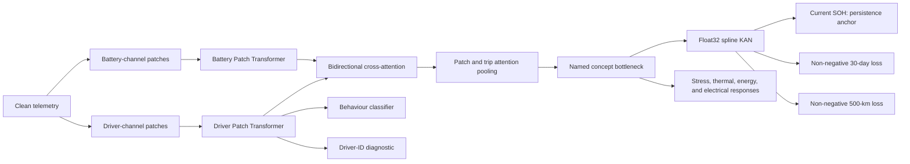

# DB-PatchKAN Complete Research Record

## Driver Behaviour, Explainable Battery Stress, and Electric-Vehicle Battery Health Prediction

**Document status:** Final consolidated record after Stage 8 and CPU Stage 9 attribution/sensitivity  
**Project workspace:** `D:\driver`  
**Final experiment date:** 23 July 2026  
**Primary proposed framework:** **Persistence-Anchored DB-PatchKAN**  
**Full name:** Driver–Battery Dual-Stream Patch Transformer with Explainable D-BSI Concept Bottleneck and KAN Fusion  
**Primary datasets:** Nissan Leaf real-world telemetry, RWTH Electric Vehicle and Battery Data, and the EVE Pilot  
**Final locked-test status:** Opened once for Stage 8 inference; subsequent model tuning on that split is prohibited; Stage 9 did not read it  

---

## 1. Purpose of this document

This document is the authoritative, end-to-end scientific record of the work completed in this project. It records:

- the original objectives and the final scope;
- every dataset used, its label definition, sampling structure, limitations, and role;
- the raw-data audit, cleaning, quality-control, resampling, feature engineering, and leakage controls;
- driver-behaviour discovery and classification;
- the mathematical and physical connection between driver actions, battery stress, and battery health;
- the explainable Driver–Battery Stress Index, or D-BSI;
- dimensionality reduction and feature-selection procedures;
- the complete DB-PatchKAN architecture;
- current-SOH and future-degradation targets;
- the auxiliary electrical, thermal, energy, and stress outputs;
- classical, temporal deep-learning, KAN, and persistence baselines;
- ablations, external validation, explainability, uncertainty, and robustness analyses;
- the chronological record of Stages 0–8, including failed, corrected, exploratory, and final experiments;
- the final one-time locked-test result;
- what the evidence does and does not support;
- reproducibility assets, notebooks, archives, and workbook structure.

Earlier results are not silently discarded. Where a later experiment corrected or superseded an earlier one, both are documented and the authoritative result is identified.

---

## 2. Research objectives and final outcomes

### Objective 1 — Analyse the influence of driver behaviour on battery degradation

The project established and tested the following physical pathway:

> driver kinematics and control actions → traction/regeneration current and power → C-rate, current transients, heat generation, SOC exposure, and energy throughput → trip stress dose → cumulative stress exposure → future capacity/SOH change.

The strongest evidence is for the immediate driver-to-battery-response portion of this pathway. Across external vehicles, driver and route variables substantially improved prediction of peak C-rate, high-current exposure, electrothermal intensity, thermal response or its proxy, energy consumption, and D-BSI. Direct causal attribution of long-term degradation to driving style was not established because independent longitudinal health labels were sparse.

### Objective 2 — Develop intelligent models for automated driver-behaviour discovery

An unsupervised behaviour-discovery pipeline was implemented:

`RobustScaler → PCA retaining 95% variance → GMM`, with K-means, DBSCAN, and HDBSCAN comparisons.

Behaviour was described as Eco, Balanced, or Aggressive by ranking fold-fitted clusters on an aggression score and applying training-fold tertiles. A Random Forest reproduced the final pseudo-labels on 26 held-out Nissan trips with macro-F1 `0.8662`. This is a leakage-controlled pseudo-label reproduction result, not validation against human-labelled driving style. The full-development clustering was not sufficiently stable and therefore remains exploratory.

### Objective 3 — Design an explainable Battery Stress Index

The six-component D-BSI was implemented with transparent electrical, thermal, SOC, cycle/throughput, transient, and interaction terms. Every score can be decomposed into its component contributions and converted into a duration-weighted stress dose.

### Objective 4 — Develop an explainable SOH-prediction framework

The resulting model is a dual-stream, one-dimensional Patch Transformer that separately encodes driver and battery telemetry, learns their response coupling through bidirectional cross-attention, predicts named physical concepts, and passes only those named concepts to a compact spline KAN. Current SOH is persistence anchored. The Nissan future-health branch represents degradation as a non-negative loss from the last known SOH; the EVBattery forecasting branch uses a signed residual from current capacity because repeated pack-level capacity labels contain measurement and recalibration increases that should not be silently clipped.

### Objective 5 — Validate on real-world datasets and compare with existing methods

The framework and its physical-response pathway were evaluated using:

- one Nissan Leaf with BMS-reported SOH;
- nine RWTH EVs with controlled capacity-checkpoint labels;
- one EVE Renault Zoe with longitudinal BMS-reported SOH;
- 191 Tsinghua EVBattery vehicles with repeated manufacturer-supplied partial-window capacity measurements and charging snippets.

The work included classical baselines, temporal neural baselines, matched MLP comparisons, modality and concept ablations, physics variants, external leave-one-vehicle-out and vehicle-disjoint validation, chronological validation, multi-seed training, paired vehicle-cluster bootstrap confidence intervals, conformal prediction intervals, and one-time locked-test inference.

---

## 3. Final scientific position

The project does **not** support the statement that KAN or DB-PatchKAN wins on every task.

The defensible final position is:

1. Driver behaviour has strong, externally repeatable predictive relationships with immediate battery electrical and thermal stress responses.
2. Persistence is the strongest and safest current-SOH predictor in these slowly varying, small-label datasets.
3. On the Nissan one-time locked test, persistence-anchored DB-PatchKAN significantly improved 500-km SOH-loss prediction over strict persistence.
4. The matched persistence-anchored MLP produced almost the same 500-km result; therefore the test does not prove KAN is more accurate than MLP.
5. KAN remains the selected explainable head because it maps named physical concepts through inspectable spline functions, not because it universally wins on accuracy.
6. On RWTH and EVE external health prediction, persistence remained the safest choice and the learned degradation increment did not produce a reliable improvement.
7. On the 191-vehicle EVBattery next-capacity task, persistence-anchored KAN improved MAE over persistence from `0.443366` to `0.438141 Ah`; the paired vehicle interval for KAN minus persistence was `[-0.007464,-0.003116] Ah`. The improvement is small, is strongest at horizons above 2,000 km, and is not uniform across manufacturers or short horizons.
8. The matched persistence-anchored MLP had a slightly lower point MAE (`0.437446 Ah`), but its paired difference from KAN was statistically unresolved. Stage 13 therefore supports persistence anchoring and a learned residual, not universal KAN accuracy superiority.
9. In the frozen Stage 13B comparison with recent 2024–2025 methods, TSLANet achieved the lowest MAE (`0.437087 Ah`) and reliably outperformed DB-PatchKAN by a small vehicle-level margin: KAN minus TSLANet `+0.001288 Ah`, 95% CI `[0.000201,0.002376]`. DB-PatchKAN was statistically tied with ModernTCN and KAN-Linformer.
10. In the explicitly post-hoc Stage 13C state-space comparison, TimePro achieved `0.441693 Ah` MAE and reliably improved over persistence, but DB-PatchKAN reliably outperformed TimePro by `0.003620 Ah`, 95% CI `[-0.005450,-0.001804]`. TimePro did not change the Stage 13B ranking.
11. The evidence supports a predictive driver–stress pathway. It does not yet establish a causal driver-behaviour-to-long-term-degradation law.

### 3.1 Review-priority completion matrix

The following items are stated explicitly because several were already completed before they were later suggested as missing:

| Review recommendation | Final status | Exact evidence |
|---|---|---|
| Add a persistence baseline | Complete, highest priority | Persistence was evaluated on Nissan, RWTH, EVE, and EVBattery; it is also the final current-health anchor |
| Demonstrate significant improvement over persistence | Complete on two bounded targets | Nissan locked 500-km loss: KAN delta `-0.02911 pp`, 95% CI `[-0.05261,-0.00671]`, n=8. EVBattery next-capacity forecast: KAN vehicle-macro delta `-0.005274 Ah`, 95% CI `[-0.007464,-0.003116]`, 191 vehicles |
| Quantify driver behaviour after other aging sources | Complete as a CPU residual sensitivity, not causal attribution | Stage 9 nested calendar → usage → charging proxy → temperature → driver analysis |
| Separate calendar, charging, temperature, and driver effects | Partially identifiable and now quantified | Nissan and RWTH have charging proxies; EVE charging is unavailable; all out-of-sample increments are reported, including negative ones |
| Differentiate experimentally from D2B and EV-DOS | Complete at design level with matched CPU surrogates | Exact reproductions were impossible without original simulators/code; matched cumulative-physics and physics-feature surrogates were evaluated on identical folds |
| Use real telemetry | Complete | Nissan, nine RWTH vehicles, EVE, and charging telemetry from 191 EVBattery vehicles |
| Use an explicit semi-empirical NMC degradation model | Complete as a sensitivity model | `Pack-SE-NMC-v1` explicitly separates calendar, cycle, charging-proxy, transient, Arrhenius, and pack-heterogeneity terms |
| Use an interpretable concept bottleneck | Complete | Six D-BSI components or final total D-BSI plus named physical/behaviour concepts |
| Use persistence-anchored forecasting | Complete | Nissan uses current SOH minus a non-negative future loss; EVBattery Stage 13 uses current capacity plus a learned signed residual for the next distinct-mileage checkpoint |
| Validate cell-to-pack assumptions | Complete as uncertainty/sensitivity, not chemistry calibration | 2,000 simulations per interval vary activation energies, temperature bias, usable capacity, SOC bias, pack heterogeneity, and temperature spread |
| Compare with recent 2024–2025 sequence methods | Complete | Frozen Stage 13B comparison adds ModernTCN, TSLANet, and battery-specific KAN-Linformer on identical vehicle folds, seeds, inputs, anchors, and paired bootstrap tests |
| Cover the state-space/Mamba family | Complete as post-hoc supplementary evidence | Stage 13C adds an ICML-2025 TimePro architecture-faithful adaptation using frozen Stage 13B predictions; DB-PatchKAN and TSLANet both reliably outperform it |

“Complete as a sensitivity model” does not mean that a manufacturer-calibrated electrochemical pack-aging law has been obtained. No cell-specific Schmalstieg/Ecker coefficients were transferred directly to the three packs.

---

## 4. Experimental evidence levels

The study contains different units of evidence that must not be mixed:

| Evidence level | Unit | Purpose | Independence |
|---|---|---|---|
| Telemetry sample | Time row | Cleaning, integration, channel construction | Highly autocorrelated |
| Temporal segment | 256-second window or 128-step external sequence | Representation learning | Overlapping segments are not independent labels |
| Trip | Entire trip | Behaviour and immediate response | Primary unit for Nissan/RWTH/EVE trip results |
| Health checkpoint | A dated SOH/capacity observation | Current health | Sparse |
| Degradation interval | Change between health checkpoints | Future loss | Very sparse |
| Vehicle | One EV | External generalisation | Primary RWTH outer grouping |

Millions of telemetry rows increase representation-learning data, but they do not create millions of independent SOH labels. All headline metrics use trips, checkpoints, intervals, vehicles, or seed/fold summaries rather than treating overlapping windows as independent observations.

---

## 5. Dataset overview

| Dataset | Vehicles | Main telemetry | Health label | Health scale | Main validation role |
|---|---:|---|---|---|---|
| Nissan Leaf | 1 | High-rate driving, battery, thermal, SOC, controls | BMS-reported SOH | BMS percentage | Model development and one-time final locked test |
| RWTH | 9 | Field speed, current, voltage, SOC, ambient, odometer | Controlled discharge capacity checkpoints | Capacity-based SOH | Leave-one-vehicle-out external validation |
| EVE Pilot | 1 | Longitudinal irregular telemetry with measured module temperatures | BMS-reported SOH | BMS percentage | Chronological external validation |

The Nissan and EVE BMS labels and the RWTH capacity-derived labels are not pooled as if they are the same measurement. Separate domain/calibration treatment is retained.

---

## 6. Nissan Leaf dataset

### 6.1 Vehicle and source

- Vehicle: one 2018 Nissan Leaf, nominal 40-kWh pack.
- Source file: `Nissan Leaf Real-World Data (1) (1).csv`
- Raw file size: `443,747,562` bytes.
- SHA-256: `609efebf1004f5694a1c5af9e3bc56ee11eed2f5b47b07aa736bc701c3918e81`
- Raw rows: `1,918,299`.
- Approximate native sampling: 4 Hz, with irregularities and gaps.
- Trips: `127`.
- Distinct BMS-SOH values / health anchors: `56`.
- Raw source fields: `32`.

This is a single-vehicle dataset. It is valuable for high-resolution driver–battery coupling but cannot by itself establish fleet-wide degradation generalisation.

### 6.2 Split structure

The chronological trip split was:

- training: 81 trips;
- development validation: 20 trips;
- locked final test: 26 trips.

The first 101 trips formed the development set. They produced:

- 4,801 training windows;
- 884 validation windows;
- 5,685 total development windows.

The 26 locked trips produced 1,257 windows.

Health-target availability in the NPZ tensors was:

| Split | Current-SOH windows | 30-day-loss windows | 500-km-loss windows |
|---|---:|---:|---:|
| Train | 4,801 | 1,465 | 1,580 |
| Validation | 884 | 93 | 115 |
| Locked test | 1,257 | 0 | 341 |

The final evaluation first pooled windows hierarchically to trips. The locked test therefore contained:

- current SOH: 26 trip labels;
- 30-day loss: 0 labels;
- 500-km loss: 8 trip labels.

There can be no locked-test claim for 30-day degradation because the final split has no eligible 30-day target.

### 6.3 Generated table sizes

The CPU preprocessing and analysis pipeline created:

| Table | Rows |
|---|---:|
| Deterministic raw sample | 27,651 |
| Window features | 6,129 |
| Trip features | 127 |
| Health windows/checkpoints | 56 |
| D-BSI trip results | 127 |

Across the complete Nissan dataset, 28 eligible 30-day and 41 eligible 500-km health targets were generated before chronological splitting.

### 6.4 Raw fields and treatment

| Source field | Meaning | Treatment and use |
|---|---|---|
| `index` | Source row identifier | Lineage only; never a predictor |
| `Timestamp` | Observation time | Parsed at microsecond precision, converted consistently to UTC, used for ordering, integration, gaps, and splits |
| `Speed` | Vehicle speed | Driver stream; acceleration, jerk, distance, and speed statistics |
| `Odometer` | Cumulative distance | QC, mileage, and explicit aging control; not a behaviour feature |
| `RPM` | Motor speed | Sentinel `16383` removed; optional gated driver channel |
| `SOC` | State of charge | Battery stream, SOC exposure, and D-BSI |
| `SOH` | BMS-reported health | Target only; excluded from predictors except the permitted past anchor in forecasting |
| `Torque` | Motor torque | Optional driver/control channel and trip statistics |
| `Motor_Temp` | Motor temperature | `-40` sentinel set missing; contextual variable |
| `TP_FR`, `TP_FL`, `TP_RR`, `TP_RL` | Tyre pressures | Invalid/zero values set missing; secondary context |
| `Aux_Pwr_100W` | Auxiliary power | Converted to physical units; context and auxiliary energy |
| `AC_Pwr_250W` | Air-conditioning power | HVAC context |
| `EstPwr_AC_50W` | Estimated AC power | Audited against AC field; one cleaned representative retained |
| `HV_Bat_Voltage` | Pack voltage | Battery stream; `0` and `655.35` sentinels invalidated |
| `Brake` | Brake input/count | Brake-active fraction, events, and percentiles |
| `Acc_Pedal` | Accelerator position | Normalised to `[0,1]` using the source scale; driver stream |
| `ECO` | ECO mode/status | Optional gated driver channel |
| `ePedal` | e-Pedal status | Optional gated driver channel |
| `HV_Bat_Current_2` | Pack current | Sign canonicalised to discharge-positive; battery stream, power, C-rate, Ah, EFC |
| `Ambient_C_Temp` | Ambient temperature | Thermal/context channel and adjustment variable |
| `Pack_1_C_Temp` | Battery sensor temperature | Used with sensors 2 and 4 to recompute mean/spread |
| `Pack_2_C_Temp` | Battery sensor temperature | Used with sensors 1 and 4 |
| `Pack_4_C_Temp` | Battery sensor temperature | Used with sensors 1 and 2 |
| `Pack_Avg_C_Temp` | Source average pack temperature | Audit only; replaced by the recomputed sensor mean |
| `kWh_Remaining` | Estimated remaining energy | Descriptive/leakage benchmark only; excluded from SOH predictors |
| `Horsepower` | Derived mechanical power | Redundant diagnostic only |
| `Instant_kW` | Source instantaneous power | Audit only; replaced by recalculated voltage × current |
| `Driver_ID` | Driver identity | Secondary classification target/group key; excluded from SOH prediction |
| `Trip` | Trip identifier | Grouping, lineage, and leakage control; excluded as a predictor |

### 6.5 Nissan quality-control results

| Rule | Condition | Rows affected | Trips affected |
|---|---|---:|---:|
| Q01 | Invalid timestamp | 0 | 0 |
| Q02 | Invalid speed | 0 | 0 |
| Q03 | Invalid SOC | 0 | 0 |
| Q04 | Pack-voltage sentinel/invalid | 3 | 3 |
| Q05 | Invalid current | 0 | 0 |
| Q06 | Invalid pack temperature | 0 | 0 |
| Q07 | RPM sentinel | 16 | 4 |
| Q08 | Motor-temperature sentinel | 3,479 | 24 |
| Q09 | Invalid tyre pressure | 225,282 | 87 |
| Q10 | Invalid pedal/brake | 0 | 0 |
| Q11 | Invalid ECO/e-Pedal mode | 0 | 0 |
| Q12 | Invalid context/power field | 2 | 1 |
| Q13 | Invalid odometer | 5 | 2 |

The cleaned native-rate Parquet file is approximately `310.6 MB`; the one-second Parquet representation is approximately `93.5 MB`.

### 6.6 Resampling and segmentation

- Integration of power, energy, distance, and Ah used native timestamps.
- A time gap greater than 2 seconds started a new continuous segment.
- Short gaps could be interpolated only up to 2 seconds.
- One-second values were obtained by within-second median aggregation.
- Acceleration and jerk were derived after a three-point median filter at 1 Hz.
- Stable model segments were 256 seconds long.
- Actual generated overlap stride was 64 seconds.
- A valid segment required at least 80% temporal coverage.
- Windows never crossed trips or discontinuities.
- Every overlapping window from a trip stayed in the same data fold.

### 6.7 Model channels

The raw driver stream contained nine channels:

1. speed;
2. acceleration;
3. jerk;
4. torque;
5. accelerator position;
6. brake activity;
7. absolute RPM;
8. ECO status;
9. e-Pedal status.

The raw battery stream contained seven channels:

1. clean pack voltage;
2. canonical discharge-positive current;
3. SOC;
4. recomputed pack mean temperature;
5. pack-temperature spread;
6. ambient temperature;
7. HVAC/auxiliary load.

Each stream also received validity, time-delta, relative-position, and missingness information. The implemented configuration therefore used 13 driver-side and 11 battery-side channels.

Protected driver indices were `0, 9, 10, 11, 12`. Protected battery indices were `0, 1, 2, 3, 7, 8, 9, 10`. Protected channels were not removed by stochastic feature gates.

### 6.8 Nissan label caveats

- SOH is reported by the vehicle BMS, not independently measured laboratory capacity.
- BMS values contain plateaus and recalibration effects.
- Only one vehicle is represented.
- There are 56 health anchors, not 1.9 million independent health observations.
- For current SOH, the last known SOH is an exceptionally strong predictor.
- Development labels are much denser for current SOH than for the two future-loss tasks.

---

## 7. RWTH Electric Vehicle and Battery Data

### 7.1 Source and composition

- Local archive: `data\external\rwth\Electric_Vehicle_and_Battery_Data.zip`
- Archive size: `85,985,096` bytes.
- SHA-256: `e72521395e00dcf9788347eba1d13af15e930057786cb881259ba611dee82a98`
- Vehicles: 9.
- Vehicle identifiers: Smart-1 through Smart-6, iMiEV-1, iOn-1, and iOn-2.
- Raw field-test rows: `5,309,118`.
- Mapped usable rows: `4,680,222`.
- Trip-feature rows: `14,167`.
- Stage 7 fixed external sequences: `13,418`.

The archive includes field tests, capacity tests, charging curves, trip data, and source documentation.

### 7.2 Per-vehicle mapping

| Vehicle | Source rows | Mapped rows | Derived trips | Published trip reference |
|---|---:|---:|---:|---:|
| iMiEV-1 | 1,125,502 | 566,163 | 1,508 | 1,508 |
| iOn-1 | 300,092 | 297,015 | 480 | 480 |
| iOn-2 | 523,149 | 518,035 | 1,063 | 1,064 |
| Smart-1 | 1,516,643 | 1,500,343 | 5,660 | 5,708 |
| Smart-2 | 598,803 | 592,788 | 2,171 | 2,190 |
| Smart-3 | 506,307 | 499,715 | 2,177 | 2,192 |
| Smart-4 | 106,203 | 105,839 | 219 | 233 |
| Smart-5 | 129,490 | 101,338 | 200 | 218 |
| Smart-6 | 502,929 | 498,986 | 689 | 1,411 |

Differences from published trip counts arise from the explicit mapping, continuity, and validity rules used by this project. They are retained as an audit item rather than hidden.

### 7.3 RWTH raw fields

The common field telemetry includes:

- MATLAB serial time (`time_num`);
- speed;
- odometer;
- ambient temperature;
- real SOC;
- current;
- voltage;
- power.

The source current convention is negative during discharge. It was multiplied by `-1` to create the project-wide discharge-positive convention.

### 7.3.1 RWTH trip definitions and charging observability

The RWTH source provides four trip-metadata aggregation levels:

- `datafile`: ignition on to ignition off;
- `20min`: consecutive ignition sessions separated by less than 20 minutes are combined;
- `1h`: consecutive sessions separated by less than one hour are combined;
- `charge`: starts when the EV is unplugged and ends when it is plugged in again.

Stage 9 used the `charge` level to obtain:

- number of plug-in cycles;
- distance and time between plug-ins;
- SOC immediately after unplugging;
- SOC at the next plug-in;
- charge-to-charge SOC depth;
- high-SOC restart count.

The field data do not contain the charging process because logging stops when the ignition is off. Consequently, actual charging current, charging power, CC/CV duration, and fast-charge exposure cannot be reconstructed. The separate laboratory charging curves at selected power settings describe vehicle-type behaviour, not the historical charging session assigned to each field interval.

### 7.4 Capacity labels

The dataset provides controlled capacity-test checkpoints. These are not the same as a BMS SOH percentage.

- Published capacity checkpoints: 20.
- Vehicles with repeated checkpoints: 5.
- Checkpoints linkable to prior field exposure: 16.
- Degradation intervals between checkpoints: 11.
- Intervals with usable preceding field-exposure summaries: 8.

The Stage 7 degradation experiment therefore had only eight externally linked degradation intervals. The four applicable held-out health vehicles were Smart-1, Smart-2, Smart-3, and iMiEV-1.

Capacity was recalculated within fixed pack-voltage windows:

| Family | Nominal capacity | Series cells | Cell-voltage window | Initial fixed-window capacity |
|---|---:|---:|---|---:|
| Smart | 52 Ah | 93 | 3.357–3.914 V | 40.76 Ah |
| iMiEV/iOn | 50 Ah | 88 | 3.517–3.933 V | 36.94 Ah |

Capacity SOH was defined as:

\[
SOH_{capacity}=100\times
\frac{Q_{\text{fixed-window,current}}}
{Q_{\text{fixed-window,initial family}}}.
\]

Values can exceed 100% because of measurement variation, conditioning, and the family-level reference. The recalculation audit produced a median absolute capacity error of `0.07115 Ah` and maximum absolute error of `0.78659 Ah`.

### 7.5 Thermal limitation and proxy

RWTH field telemetry does not provide battery-pack temperature. Therefore:

- no RWTH result is described as measured pack-temperature prediction;
- the thermal response is an explicitly labelled latent electrothermal proxy;
- the proxy is based on C-rate-squared excitation and first-order thermal memory.

For time constant \(\tau=1800\) seconds:

\[
\theta_k=\theta_{k-1}e^{-\Delta t/\tau}
{}+C_k^2\left(1-e^{-\Delta t/\tau}\right).
\]

### 7.6 Sequence adaptation and validation

Each usable trip was converted to one 128-step time-normalised sequence derived from its 1-Hz representation. Missing Nissan-only channels remained masked. Values were not artificially repeated to imitate a higher sampling rate.

Validation used leave-one-vehicle-out outer folds. This is the strongest cross-vehicle validation in the project.

---

## 8. EVE Pilot dataset

### 8.1 Vehicle and source

- Dataset: **The EVE Pilot: Usage Data from an Electric Car in France**.
- DOI: <https://doi.org/10.57745/5O6QIH>
- Vehicle: one 2014 Renault Zoe Q90.
- Nominal battery energy: 22 kWh.
- Maximum reported vehicle speed: 135 km/h.
- Collection: CanZE/generic lighter dongle.
- Usage: personal driving with occasional work transit.
- Period: October 2020 to October 2023.
- Licence: Etalab Open Licence 2.0, compatible with CC BY 2.0.

The source distributes signals as separate files. Exact file identifiers and checksums are retained in `eve_source_manifest.csv`.

### 8.2 Selected signals and harmonisation

Signals included:

- speed;
- odometer;
- pack current;
- pack voltage;
- SOC;
- SOH;
- ambient temperature;
- 12 measured module temperatures.

Harmonised rows: `711,880`.

The moving median source current was approximately `-21.15 A`, so the current multiplier was `-1` to create discharge-positive current.

The project used `65 Ah` as the EVE nominal capacity for C-rate calculations.

### 8.3 Alignment tolerances

The five-second speed channel formed the principal time backbone.

| Signal | Native/working cadence | Maximum backward/as-of tolerance |
|---|---:|---:|
| Speed | 5 s | Backbone |
| Current and voltage | 5 s | 30 s |
| SOC and odometer | 30 s | 5 min |
| Ambient temperature | 5 min | 90 min |
| Module temperatures | 60 s | 15 min |
| SOH | Daily/irregular | 45 days |

Pack mean temperature and temperature spread were calculated from the 12 module-temperature signals.

### 8.4 Trip creation

- A gap greater than 300 seconds split sessions.
- Minimum observations: 12.
- Minimum duration: 60 seconds.
- Minimum maximum speed: 5 km/h.
- Minimum distance: 0.2 km.

The result was:

- 1,952 valid trips;
- 1,952 Stage 7 sequences;
- 37 monthly SOH checkpoints;
- 36 monthly intervals;
- 17 distinct raw BMS-SOH values;
- 18 evaluated future rows after the chronological split.

### 8.5 EVE health labels

The monthly label was the median BMS SOH reported during that month. A past-only rolling three-month median trend was also constructed. Non-monotonic changes were retained because BMS recalibration is scientifically meaningful and must not be silently forced into a monotonic curve.

Unlike RWTH, EVE has measured battery module temperatures, so temperature rise is a measured response. Unlike RWTH, EVE contains only one vehicle, so validation used expanding chronological folds rather than leave-one-vehicle-out evaluation.

---

## 9. Cross-dataset harmonisation

The common transferable channel core was:

- speed;
- acceleration;
- jerk;
- current;
- voltage;
- SOC;
- temperature when measured;
- ambient temperature;
- validity mask;
- time delta;
- relative position.

Nissan-only channels such as pedal, torque, RPM, ECO, and e-Pedal remained optional and masked in external data.

Label domains were kept separate:

- Nissan: BMS-reported SOH;
- EVE: BMS-reported SOH aggregated monthly;
- RWTH: controlled, fixed-voltage-window capacity SOH.

Separate output calibration heads/domain assumptions prevent capacity SOH and BMS SOH from being treated as interchangeable.

---

## 10. Leakage-control protocol

### 10.1 Fields excluded from SOH predictors

- `index`;
- raw timestamp;
- trip identifier;
- driver identifier;
- current SOH, except as the explicit past anchor permitted for forecasting;
- `kWh_Remaining`;
- source horsepower;
- source `Instant_kW`;
- source `Pack_Avg_C_Temp`.

Age and odometer were permitted only as explicit aging controls or baselines, not as driver-behaviour descriptors.

### 10.2 Fold safety

All cleaning thresholds, scaling, correlation filtering, feature selection, PCA, clustering, behaviour thresholds, concept normalisation, model fitting, calibration, persistence gating, and hyperparameter choice were fitted using training data only.

Every window from the same trip remained in one fold. Forecast splits were purged by the relevant 30-day or 500-km horizon.

### 10.3 Locked-test nuance

Stage 8 maintained a hash-audited locked NPZ tensor and did not load it during deep-model selection. It was opened once after configuration and model hashes were frozen.

For complete transparency, an earlier CPU analysis had already produced classical final-holdout and behaviour summaries on the chronological last 20% of Nissan trips. Therefore, the Stage 8 split is strictly untouched relative to the deep-model selection notebooks and frozen tensor protocol, but it should not be described as globally unknown throughout every earlier exploratory CPU analysis. The fixed Stage 8 procedure, archived model hashes, and one-time opening remain valid; the thesis should disclose this distinction.

---

## 11. Dimensionality reduction and feature selection

The problem was not simply the 32 source fields. Approximately 100 engineered variables created deterministic redundancy, missingness, correlation, and multiple ways to leak or proxy the target.

### Stage A — Semantic removal

Identifiers, source-derived duplicates, direct target fields, and strong target proxies were removed as described above.

### Stage B — Statistical redundancy filtering

Inside each training fold:

- remove a field if more than 40% is missing after sentinel cleaning, unless protected by physical rules;
- remove a near-constant field when one value occupies more than 99.5% of valid observations;
- form absolute Spearman-correlation groups at \(|\rho|\ge0.90\);
- retain the physically primary and least-missing member of each group;
- treat VIF above 10 as an additional warning for linear models;
- keep deterministic quantities required for D-BSI audit calculations, while avoiding both source and recomputed copies in one predictive model.

### Stage C — Supervised fold-safe selection

Three independent selectors were used:

1. mutual-information/mRMR ranking, retaining the top 40 candidates;
2. elastic-net stability selection across 100 trip/checkpoint block bootstraps;
3. held-out grouped permutation importance from EBM or XGBoost.

A consensus candidate required:

- selection in at least 70% of outer folds;
- positive median held-out permutation importance;
- support from at least two of the three selectors.

The final feature budget was tuned inside validation over:

\[
\{8,12,16,20,24,32\}.
\]

The KAN input was capped at 20 named concepts.

### Stage D — Deep channel reduction

Each optional sequence channel received a stochastic \(L_0\)-style gate. Speed, current, voltage, SOC, pack temperature, masks, and time-delta channels were protected.

An optional channel could be pruned only if:

- its mean gate probability was below 0.5 in at least 70% of folds; and
- leave-one-channel-out external testing worsened MAE by no more than 1%.

PCA retaining 95% variance was used for behaviour clustering, visualisation, and a comparison baseline, not as the main health representation because its components obscure physical interpretation.

### Final selection finding

No Nissan feature met all four stringent robust-importance conditions across the complete fold analysis. `ambient_mean_c` passed selection, positive permutation, and shape criteria, but removal worsened error in only 25% of folds. One 500-km forecast candidate had fold-selection and positive-permutation frequencies of 0.75, but the full robustness requirement was not met.

This is a negative but important result: the small number of independent health outcomes does not justify a definitive ranked list of degradation drivers.

---

## 12. Driver-behaviour discovery

### 12.1 Behaviour features

Seventeen trip-level behaviour descriptors were used:

- e-Pedal fraction;
- speed standard deviation;
- speed 95th percentile;
- discharge current 95th percentile;
- discharge power 95th percentile;
- positive-acceleration RMS and 95th percentile;
- deceleration RMS and 95th percentile;
- jerk RMS and 95th percentile;
- accelerator-pedal mean and 95th percentile;
- brake-active fraction;
- positive-torque 95th percentile;
- harsh-acceleration events per minute;
- harsh-braking events per minute.

### 12.2 Discovery procedure

1. Fit `RobustScaler` on the training fold.
2. Fit PCA retaining 95% variance on the training fold.
3. Search Gaussian mixtures with 2–6 clusters.
4. Prefer minimum BIC subject to bootstrap ARI at least 0.75 and each cluster containing at least 5% of training trips.
5. Compare against K-means, DBSCAN, and HDBSCAN.
6. Construct a physically signed aggression score.
7. Map training-fitted aggression to Eco, Balanced, and Aggressive using training-fold thirds.
8. Train supervised models to reproduce these pseudo-labels.

### 12.3 Stability results

Outer-fold GMM selections/stabilities were:

| Fold | Selected clusters | Bootstrap ARI |
|---|---:|---:|
| 1 | 6 | 0.499 |
| 2 | 6 | 0.386 |
| 3 | 2 | 0.768 |
| 4 | 3 | 0.351 |

Only one of four folds achieved the intended ARI threshold.

The full 101-trip development GMM selected six clusters by BIC, but:

- bootstrap ARI was `0.391`;
- minimum cluster share was only `0.99%`;
- both the stability and 5% share requirements failed.

A separate 81-trip GPU training subset selected two clusters with ARI `0.775`, but the following validation labels were severely imbalanced.

### 12.4 Behaviour classifier

On the final 26 held-out trips, the selected Random Forest achieved:

| Metric | Value |
|---|---:|
| Accuracy | 0.8846 |
| Macro-F1 | 0.8662 |
| Balanced accuracy | 0.8667 |
| Log loss | 0.4323 |

Confusion matrix:

\[
\begin{bmatrix}
11 & 0 & 0\\
1 & 8 & 1\\
0 & 1 & 4
\end{bmatrix}
\]

An elastic-net logistic classifier achieved macro-F1 `0.7948`.

There was no direct SOH-label leakage: SOH was not used to form behaviour features or pseudo-labels, and held-out groups were separate. However, the classifier predicts cluster-derived labels created from substantially the same behaviour variables. It measures reproducibility of an unsupervised operational taxonomy, not agreement with an independent human ground truth. Because cluster stability was weak, the behaviour result is exploratory.

### 12.5 Driver identity

Driver-ID classification was a secondary diagnostic, restricted to IDs 0, 1, 2, and 4. Rare IDs remained descriptive. Driver-ID performance was not used to select the health model and is not a principal contribution.

---

## 13. Explainable Driver–Battery Stress Index

### 13.1 Severity functions

For a high-is-severe variable \(x\), lower threshold \(l\), and upper threshold \(u\):

\[
s_{\text{high}}(x;l,u)=
\left[
\operatorname{clip}
\left(\frac{x-l}{u-l},0,1\right)
\right]^2.
\]

For a low-is-severe variable:

\[
s_{\text{low}}(x;l,u)=
\left[
\operatorname{clip}
\left(\frac{l-x}{l-u},0,1\right)
\right]^2.
\]

The squared ramp makes low-level exposure contribute gradually while emphasising severe exposure.

### 13.2 Row-level thresholds

| Stressor | Lower transition | Severe limit |
|---|---:|---:|
| Discharge C-rate | 0.5 C | 3.0 C |
| Regenerative C-rate | 0.3 C | 1.5 C |
| Hot pack temperature | 30°C | 45°C |
| Cold regenerative condition | 10°C | 0°C |
| Pack-temperature spread | 3°C | 10°C |
| High SOC | 80% | 100% |
| Low SOC | 20% | 0% |
| C-rate slew/transient | 0.1 C/s | 1.0 C/s |

Cold severity contributes primarily when combined with regeneration because charging a cold cell is the relevant risk mechanism.

### 13.3 Six D-BSI components

\[
S_{rate}=0.75s_{discharge}+0.25s_{regen}
\]

\[
S_{thermal}=0.70s_{hot}+0.20s_{cold,regen}+0.10s_{spread}
\]

\[
S_{soc}=0.70s_{highSOC}+0.30s_{lowSOC}
\]

\[
S_{cycle}=0.50s(DoD;20,80)
{}+0.50s(EFC_{rate};0.25/h,1/h)
\]

\[
S_{transient}=s_{\lvert \Delta C/\Delta t\rvert}
\]

\[
S_{interaction}=0.50s_{hot\_discharge}
{}+0.50s_{boundary\_regen}.
\]

### 13.4 Total D-BSI and stress dose

\[
\begin{aligned}
D\text{-}BSI=100(&0.25S_{rate}
{}+0.25S_{thermal}
{}+0.15S_{soc}\\
&{}+0.15S_{cycle}
{}+0.10S_{transient}
{}+0.10S_{interaction}).
\end{aligned}
\]

\[
StressDose=
\frac{D\text{-}BSI}{100}\times Duration_{hours}.
\]

The six components, weighted contributions, total score, trip dose, and cumulative dose are retained. A fitted non-negative reweighting is only a sensitivity model; it does not replace transparent D-BSI v1.

### 13.5 Absolute and fold-local stress classes

The fixed explanatory bands are:

- low: below 25;
- moderate: 25 to below 50;
- high: 50 to below 75;
- severe: 75 or above.

On Nissan:

- mean D-BSI: `4.0185`;
- median: `4.1853`;
- maximum: `21.7029`;
- all 127 trips fall in the fixed “low” band.

Therefore, the Low/Moderate/High classification experiment used training-fold tertiles rather than the absolute v1 bands. The tertile class is a relative within-dataset warning category and must not be described as the absolute D-BSI severity band.

### 13.6 Scope

D-BSI is an operational driving-stress measure. It is not a complete battery-aging law. It does not fully represent:

- charging history;
- calendar storage;
- cell chemistry;
- pack cooling-control details;
- internal resistance changes;
- lithium plating;
- manufacturing variation;
- repair or replacement history.

---

## 14. Mathematical and physical driver-to-health connection

### 14.1 Electrical conversion

With discharge-positive current:

\[
P_{battery,kW}=\frac{V I}{1000}.
\]

The absolute C-rate is:

\[
C(t)=\frac{|I(t)|}{Q_{nominal}}.
\]

Ah throughput is:

\[
Ah_{throughput}=\int \frac{|I(t)|}{3600}\,dt.
\]

Equivalent full cycles are approximated by:

\[
EFC=\frac{Ah_{throughput}}{2Q_{nominal}}.
\]

### 14.2 Current-squared and electrothermal dose

Ohmic heating is proportional to:

\[
P_{Joule}=I^2R.
\]

When resistance is not measured, C-rate squared provides a scale-normalised excitation:

\[
D_{C^2}=\int C(t)^2\,dt.
\]

Temperature acceleration relative to 25°C is represented by an Arrhenius factor:

\[
A(T)=
\exp\left[
\frac{E_a}{R}
\left(
\frac{1}{298.15}
-\frac{1}{T+273.15}
\right)
\right],
\]

with \(E_a=35\text{ kJ mol}^{-1}\).

The electrothermal dose is:

\[
D_{ET}=\int C(t)^2A(T(t))\,dt.
\]

Where temperature is unavailable, the RWTH first-order thermal-memory proxy is used and explicitly labelled as a proxy.

### 14.3 Transients and thermal response

\[
C_{slew}(t)=\frac{|\Delta C|}{\Delta t}.
\]

\[
\Delta T_{pack}=T_{pack,end}-T_{pack,start}.
\]

Ambient-adjusted temperature rise models the part of the pack response not explained by starting/ambient conditions.

### 14.4 Energy response

\[
Energy_{100km}=
100\frac{E_{discharge,kWh}}{Distance_{km}}.
\]

This validates whether speed, acceleration, braking, route conditions, ambient temperature, and auxiliary/HVAC load produce the expected energy-demand response.

### 14.5 Proposed degradation relationship

For trip \(j\), define a vector of physically named responses:

\[
\mathbf z_j=
[S_{rate},S_{thermal},S_{soc},S_{cycle},
S_{transient},S_{interaction},D_{ET},EFC,\ldots].
\]

The cumulative exposure before health checkpoint \(k\) is:

\[
\mathbf Z_k=\sum_{j:t_j<t_k}
\mathbf z_j\,Duration_j.
\]

The explainable health model is:

\[
\widehat{\Delta SOH}_{k,h}
=
f_{KAN}
\left(
\widehat{\mathbf Z}_{k},
Age_k,
Mileage_k,
SOH_{anchor,k}
\right),
\]

subject to:

\[
\widehat{\Delta SOH}_{k,h}\ge0,
\qquad
\widehat{SOH}_{k+h}
=SOH_{anchor,k}-\widehat{\Delta SOH}_{k,h}.
\]

This is the mathematical bridge between behaviour and health: the Transformer learns the driver-action–battery-response mapping, the named concepts expose the physical response, and the KAN models a nonlinear health-loss function over those concepts and aging controls.

This is predictive and physics-guided, not a proof of causality or a cell-electrochemistry replacement.

### 14.6 Pack-SE-NMC-v1 semi-empirical sensitivity law

CPU Stage 9 added an explicit pack-aware NMC sensitivity model. It is deliberately a semi-empirical stress law rather than a claim that a cell-calibrated Schmalstieg or Ecker equation transfers directly to an EV pack.

Because Stage 8 architecture selection and the Nissan locked test were already closed, Pack-SE-NMC-v1 was **not** retrofitted into or used to retune the frozen DB-PatchKAN checkpoints. It is an independently evaluated CPU physics baseline and sensitivity layer. Integrating it as a new neural concept would create a new architecture requiring a new untouched test set.

For an interval of \(t_d\) days:

\[
d_{cal}=
\sqrt{\frac{t_d}{365.25}}\,
A(T,E_{a,cal})
\left[1+1.5\left(\frac{SOC}{100}\right)^2\right].
\]

The cycle term is:

\[
\begin{aligned}
d_{cyc}={}&
\frac{EFC}{s_Q}
A(T,E_{a,cyc})
\left(\frac{DoD}{80}\right)^{1.3}
\left(1+0.5\frac{D_{C^2}}{H}\right)\\
&\times h_{pack}
\left[1+0.5\left(\frac{\Delta T_{spread}}{10}\right)^2\right],
\end{aligned}
\]

where \(s_Q\) is uncertain usable-capacity scale, \(H\) is exposure duration, and \(h_{pack}\) represents unobserved pack heterogeneity.

The charging-proxy term is:

\[
d_{chg}=
N_{chg}\frac{\overline{\Delta SOC}_{chg}}{100}
\left[
1+
\operatorname{clip}
\left(
\frac{SOC_{plug}-80}{20},0,1
\right)^2
\right].
\]

The transient term is:

\[
d_{tr}=\sqrt{D_{transient}+\epsilon}.
\]

The complete uncalibrated interval damage index is:

\[
D_{PackSE}=d_{cal}+d_{cyc}+d_{chg}+d_{tr}.
\]

Capacity-loss mapping uses non-negative least squares fitted exclusively inside each training fold:

\[
\widehat{\Delta SOH}^{+}
=
\beta_{cal}d_{cal}
{}+\beta_{cyc}d_{cyc}
{}+\beta_{chg}d_{chg}
{}+\beta_{tr}d_{tr},
\qquad
\boldsymbol{\beta}\ge0.
\]

This produces an explicit, auditable baseline while avoiding unvalidated direct transfer of cell coefficients.

### 14.7 Pack-level uncertainty protocol

For every eligible interval, Stage 9 ran 2,000 Monte Carlo simulations. The uncertain assumptions were:

| Parameter | Sampling assumption |
|---|---|
| Calendar activation energy | Normal around 35 kJ/mol, SD 5, clipped 20–50 |
| Cycle activation energy | Normal around 25 kJ/mol, SD 5, clipped 10–45 |
| Pack-temperature bias | Normal 0°C, SD 2°C, clipped ±6°C |
| Usable-capacity scale | Normal 1.00, SD 0.05, clipped 0.85–1.15 |
| Pack heterogeneity multiplier | Normal 1.00, SD 0.10, clipped 0.70–1.30 |
| SOC bias | Normal 0 percentage points, SD 3, clipped ±9 |
| Measured temperature spread | Normal around measured spread, SD 0.5°C |
| Unmeasured RWTH spread | Prior normal 2°C, SD 1.5°C, clipped 0–10°C |

The resulting raw damage-index sensitivity was:

| Dataset | Intervals | Measured pack spread | Median relative 90% width | Median pack correction |
|---|---:|---:|---:|---:|
| Nissan development | 43 | 100% | 11.61% | +0.368% |
| RWTH | 8 | 0% | 1.50% | +0.041% |
| EVE | 35 | 100% | 1.87% | +0.032% |

These widths quantify parameter uncertainty in the stated stress law. They do not include chemistry misidentification, cooling-control error, structural model-form error, or uncertainty in the learned loss-mapping coefficients. They are therefore lower bounds on total pack-level uncertainty.

Dominant median absolute Spearman sensitivities were:

- Nissan: temperature bias `0.770`, pack heterogeneity `0.377`, SOC bias `0.191`;
- RWTH: temperature bias `0.685`, calendar activation energy `0.612`, SOC bias `0.214`;
- EVE: pack heterogeneity `0.627`, temperature bias `0.557`, usable-capacity scale `0.307`.

The physical conclusion is not that the corrections are universally small. It is that the chosen raw damage index is most sensitive to temperature and pack heterogeneity, while the absence of RWTH pack-temperature measurements creates structural uncertainty beyond the numerical interval.

---

## 15. Prediction tasks

### 15.1 Health tasks

1. Current trip/checkpoint SOH.
2. 30±7-day future SOH loss.
3. 500±100-km future SOH loss.
4. Future SOH, reconstructed as anchor SOH minus non-negative predicted loss.

### 15.2 Driver tasks

1. Eco/Balanced/Aggressive operational behaviour.
2. Secondary Driver-ID diagnostic.

### 15.3 Immediate response tasks

1. Ambient-adjusted pack-temperature rise.
2. Trip energy consumption in kWh/100 km.
3. Peak C-rate.
4. Maximum pack temperature when measured.
5. Temperature rise.
6. High-current exposure duration/fraction.
7. High-SOC/high-temperature exposure duration.
8. Electrothermal intensity.
9. D-BSI or transferable partial/response D-BSI.
10. Low/Moderate/High fold-relative stress probability.

### 15.4 Uncertainty

Regression outputs include prediction intervals where sample size permits. The target presentation is:

\[
\widehat{SOH}=93.2\%\quad[92.8\%,93.6\%].
\]

Coverage and interval width are both reported. A wide interval with nominal coverage is not automatically useful, and several development intervals were undercalibrated.

---

## 16. DB-PatchKAN architecture



### 16.1 Patch representation

This is not an image ViT. It applies the ViT/PatchTST principle to one-dimensional multivariate telemetry.

Default Nissan configuration:

| Setting | Value |
|---|---:|
| Sampling | 1 Hz |
| Segment length | 256 s |
| Patch length | 16 s |
| Patch stride | 8 s |
| Patches per segment | 31 |
| Driver encoder blocks | 3 |
| Battery encoder blocks | 3 |
| Embedding dimension | 128 |
| Attention heads | 4 |
| Transformer FFN | 256 |
| Cross-attention | One bidirectional block |
| Dropout | 0.10, with selected runs at 0.20 |
| Normalisation | Pre-layer normalisation |

Each flattened patch is linearly projected to 128 dimensions, receives learned position embeddings and dropout, and is processed by a pre-normalised Transformer encoder with GELU feed-forward layers.

### 16.2 Cross-attention and pooling

Driver patches attend to battery patches and battery patches attend to driver patches. The two outputs are layer-normalised. Ablations include direct concatenation and one-way attention.

Attention pooling combines patches within a segment. Hierarchical attention then combines overlapping segments into one trip/checkpoint representation, preventing long trips from becoming many independent health labels.

Attention weights are not presented as feature importance by themselves.

### 16.3 Self-supervised pretraining

Pretraining uses telemetry without health labels:

- mask 40% of contiguous patches;
- reconstruct masked driver channels;
- reconstruct masked battery channels;
- align simultaneous driver and battery embeddings using a symmetric contrastive objective;
- use other trips as negatives;
- exclude future held-out trips and vehicles even from self-supervised fitting.

\[
L_{pre}=L_{masked-driver}
{}+L_{masked-battery}
{}+0.1L_{alignment}.
\]

### 16.4 Concept bottleneck

The original maximum-20 concept set contained:

1. D-BSI rate;
2. D-BSI thermal;
3. D-BSI SOC;
4. D-BSI cycle;
5. D-BSI transient;
6. D-BSI interaction;
7. Eco proportion;
8. Balanced proportion;
9. Aggressive proportion;
10. calendar age;
11. odometer;
12. cumulative stress dose;
13. last known SOH;
14. positive-acceleration RMS;
15. jerk RMS;
16. energy/100 km;
17. maximum pack temperature;
18. Ah throughput;
19. regeneration fraction;
20. stop fraction.

The frozen Stage 8 final model used 15 concepts:

1. total D-BSI;
2. Eco proportion;
3. Balanced proportion;
4. Aggressive proportion;
5. calendar age;
6. odometer;
7. cumulative stress dose;
8. last known SOH;
9. positive-acceleration RMS;
10. jerk RMS;
11. energy/100 km;
12. maximum pack temperature;
13. Ah throughput;
14. regeneration fraction;
15. stop fraction.

The bottleneck concept predictor is:

`128 → 128 SiLU → dropout → named concepts`.

Concept normalisation is fitted only on the training fold. Auxiliary Huber loss forces predicted concepts to agree with independently calculated concepts.

### 16.5 KAN head

The spline KAN operates only on named concepts. It does not replace every Transformer feed-forward block.

Default shape:

\[
[n_{concepts},16,8,n_{outputs}].
\]

Configuration:

- cubic B-splines;
- grid size 5;
- residual SiLU base function;
- input normalisation and bounded spline domain;
- sparsity regularisation;
- second-difference spline smoothness regularisation;
- weak-edge pruning only after training;
- fine-tuning after pruning;
- spline computations in float32 even when the Transformer uses BF16/FP16.

The Cox–de Boor spline basis is applied to bounded concept inputs. Every edge contains an inspectable univariate response curve. A parameter-matched MLP, normally `[n_concepts,32,16,n_outputs]`, is mandatory for fairness.

### 16.6 Output parameterisation

- Current SOH: final model uses strict persistence from the latest permitted past SOH.
- Future loss: `softplus(raw output)`, guaranteeing non-negative loss.
- Future health: anchor minus loss.
- Behaviour: three-class logits.
- Driver ID: diagnostic logits.

The model does not force raw historical BMS SOH to decrease monotonically because BMS plateaus and recalibration exist.

### 16.7 Training loss

Regression uses Huber loss with a one-SOH-percentage-point transition. Behaviour uses standard cross-entropy; driver ID uses class-weighted cross-entropy. Learned uncertainty weighting balances supervised tasks.

\[
L=L_{multitask}
{}+0.2L_{concept}
{}+0.1L_{physics}
{}+0.1L_{driver-ID}
{}+\lambda_{gate}L_0
{}+\lambda_{KAN}L_{KAN-reg}.
\]

The soft physical constraints enforce:

- current SOH within a plausible 0–110% interval;
- non-negative future loss;
- future SOH not greater than the anchor under the degradation forecast.

In Stage 6, the explicit physics-consistency loss was identically zero because the outputs were already hard-parameterised to satisfy these constraints. Consequently, the Stage 6 `Physics_off` ablation is not informative; Stage 4 corrected physics experiments provide the meaningful physical-response comparison.

---

## 17. Final persistence-anchored formulation

The final model name is:

> **Persistence-Anchored DB-PatchKAN**

Current health:

\[
\widehat{SOH}_{current}=SOH_{last\ known}.
\]

Future health:

\[
\widehat{SOH}_{future}
=SOH_{last\ known}
-\alpha\,
\operatorname{softplus}
\left(f_{KAN}(\mathbf c)\right).
\]

For the final Nissan model, the learned KAN loss is used directly after development selection. For external sensitivity experiments, \(\alpha\) was selected using training folds only from a conservative gate set. This allows the model to shrink toward persistence when the independent degradation evidence is insufficient.

The persistence anchor is not a competing architecture hidden inside the model. It is an explicit scientific acknowledgement that current BMS SOH changes slowly and that learned models must demonstrate incremental value over the last known measurement.

---

## 18. Compute and training environment

### 18.1 Local CPU

Used for:

- chunked CSV audit;
- CSV-to-Parquet conversion;
- timestamp, sign, and sentinel processing;
- one-second resampling;
- window, trip, concept, D-BSI, and health tables;
- behaviour clustering;
- classical models;
- workbook generation and verification;
- tests and inference smoke checks.

The full CPU pipeline passed 47 tests.

### 18.2 Kaggle T4

The planned T4 smoke/reproduction stage was skipped by user choice. No result is claimed as an independent T4 reproduction.

### 18.3 Colab A100

The neural experiments used an NVIDIA A100-SXM4 with 80 GB memory:

- Transformer precision: BF16;
- KAN spline arithmetic: float32;
- optimiser: AdamW;
- pretraining learning rate: \(3\times10^{-4}\);
- encoder fine-tuning learning rate: \(1\times10^{-5}\);
- concept/KAN/head learning rate: \(3\times10^{-4}\);
- weight decay: 0.01;
- warm-up: 5%;
- scheduler: cosine decay;
- gradient clipping: 1.0;
- final seeds: 42, 52, 62, 72, 82.

Because the Nissan health-label count is small, encoders were initially frozen during health-head training. Unfreezing was treated as an ablation.

Stage 1 KAN parameters: `1,123,949`.  
Matched MLP parameters: `1,123,109`.  
Recorded peak run VRAM: approximately `0.3456 GB`.

Notebook progress monitors sometimes displayed zero allocated GPU memory because they observed the parent process rather than the training subprocess. The internal training artifact is the authoritative memory record.

---

## 19. Baselines

### 19.1 Classical health baselines

- strict persistence;
- mean/reference prediction where applicable;
- age/mileage linear or Ridge regression;
- Elastic Net;
- RBF-SVR;
- Gaussian Process Regression where feasible;
- Random Forest;
- Extra Trees;
- XGBoost;
- Explainable Boosting Machine.

### 19.2 Behaviour baselines

- elastic-net logistic regression;
- Random Forest;
- clustering comparisons using GMM, K-means, DBSCAN, and HDBSCAN.

### 19.3 Temporal neural baselines

- 1D CNN / TCN;
- LSTM;
- GRU;
- vanilla Transformer;
- PatchTST-style model;
- iTransformer-style model;
- TimesNet-style model.

### 19.4 KAN and hybrid baselines

- additive/KAN-only variants;
- KAN-lite;
- Patch Transformer + matched MLP;
- physics-informed hybrid models;
- full DB-PatchKAN;
- exploratory full Transformer FFN-to-KAN replacement;
- persistence-anchored KAN;
- persistence-anchored matched MLP.

---

## 20. Ablations

The completed or audited ablation families include:

| Family | Variants |
|---|---|
| Input modality | Battery only; driver only; battery + driver |
| Coupling | Concatenation; one-way attention; bidirectional cross-attention |
| Pretraining | None; masked reconstruction; masked + cross-stream alignment |
| Concepts | No bottleneck; concepts + MLP; concepts + KAN |
| D-BSI | None; total only; six components; components + cumulative dose |
| Reduction | All features; stability-selected; PCA; stochastic gates |
| Physics | No explicit loss; constrained future loss; full corrected response formulation |
| KAN | MLP; spline KAN; lightweight KAN variants; full FFN-to-KAN exploratory replacement |
| Personalisation | Driver ID excluded/included |
| Encoder training | Frozen; last/all selected blocks unfrozen |
| External anchor | Pure learned loss; training-fold persistence gate; strict persistence |

Stage 6 contained an initialisation-order confound: models were constructed before the intended seed was fully applied. Stage 8 reran the key variants with corrected deterministic initialisation. Stage 8, not the raw Stage 6 ablation ranking, is authoritative for the final modality/concept comparison.

---

## 21. Validation design and metrics

### 21.1 Nissan development

Four expanding chronological folds over the first 80% of trips:

| Fold | Outer train | Outer validation | Inner train | Inner validation |
|---|---:|---:|---:|---:|
| 1 | 45 | 14 | 36 | 9 |
| 2 | 59 | 14 | 47 | 12 |
| 3 | 73 | 14 | 58 | 15 |
| 4 | 87 | 14 | 70 | 17 |

The final training/validation configuration used 87/14 development trips before the locked test.

### 21.2 External validation

- RWTH immediate and health response: leave-one-vehicle-out.
- EVE: expanding chronological validation.
- Thresholds, scaling, residualisation, and persistence gates: fitted inside the training fold.

### 21.3 Metrics

Regression:

- MAE in SOH percentage points;
- RMSE;
- bias;
- \(R^2\);
- 95th-percentile error where available;
- prediction-interval coverage and width.

Classification:

- macro-F1;
- balanced accuracy;
- log loss;
- per-class recall;
- confusion matrices.

Clustering:

- BIC;
- silhouette score;
- Davies–Bouldin index;
- bootstrap ARI;
- minimum cluster share.

Efficiency:

- parameters;
- FLOPs;
- training time;
- inference time;
- peak VRAM.

Paired bootstrap confidence intervals were used for final model comparisons. Lower MAE/RMSE is better. A negative \(R^2\) can coexist with a small MAE when the target varies only slightly; it means the model explains less variance than the relevant mean reference.

---

## 22. Chronological experiment record

## Stage 0 — Local audit, preprocessing, classical analysis, and workbook

Completed:

- immutable source manifest and hash;
- chunked audit of the 443.7-MB Nissan CSV;
- sentinel and sign cleaning;
- native-rate and one-second Parquet generation;
- window, trip, health, concept, and D-BSI tables;
- fold lineage;
- initial clustering and classical baselines;
- Excel workbook and PDF-render verification;
- 47 passing tests.

This stage established the data contract and prevented later notebooks from redefining signs, targets, or splits.

## Stage 1 — Reduced A100 tuning and smoke validation

Archive:

`outputs\colab_completed\stage1_reduced_seed42`

Notebook:

`01_colab_a100_reduced_stage1.ipynb`

Protocol:

- 81 train and 20 validation trips;
- no trip overlap;
- 10 reduced Optuna trials;
- shared self-supervised pretraining;
- approximately 30 pretraining epochs and up to 40 fine-tuning epochs in the completed run;
- locked test unused.

Best tuning configuration:

- trial 3;
- validation current-SOH MAE objective `1.2992`;
- patch length 16;
- embedding 128;
- 3 blocks;
- dropout 0.20;
- mask ratio 0.40;
- 16 concepts;
- KAN grid 5;
- KAN hidden width 8.

Validation results:

| Head | Current MAE | 30-day-loss MAE | 500-km-loss MAE | Behaviour macro-F1 | Driver-ID macro-F1 |
|---|---:|---:|---:|---:|---:|
| KAN | 1.2644 | 0.01524 | 0.03394 | 0.487 | 0.317 |
| MLP | 1.3932 | 0.00899 | 0.03754 | 1.000 | 0.374 |

The perfect MLP behaviour score was not trustworthy: the segment-level validation support was approximately 9 examples of one class, 875 of another, and no third class. Stage 1 was a tuning/smoke stage, not a final behaviour evaluation.

## Stage 1B/2 — Full selection and five-seed KAN-versus-MLP

Archive:

`outputs\colab_completed\stage1b2_full_selection`

Notebook:

`02_colab_a100_stage1b_stage2_selection.ipynb`

The aging-residual formulation was selected.

| Model | Mean current-SOH MAE | Seed SD |
|---|---:|---:|
| KAN | 0.42236 | 0.03671 |
| MLP | 0.42923 | 0.03886 |

Paired KAN minus MLP difference:

- mean: `-0.00687 pp`;
- 95% CI: `[-0.02921, 0.01872]`;
- KAN won 3 seeds and MLP won 2.

There was no statistically reliable accuracy difference. The automated simplicity rule initially selected MLP within its equivalence margin. KAN was later retained as the proposed interpretable head because it exposes spline functions over named concepts.

Important baseline context:

- age/mileage baseline MAE: `0.35065`;
- persistence MAE: `0.06350`.

Neither deep head beat persistence for current SOH.

## Stage 3 — KAN explainability

Archive:

`outputs\colab_completed\stage3_kan_explainability`

Notebook:

`03_colab_a100_kan_explainability.ipynb`

Comparative MAE:

| Model | MAE |
|---|---:|
| Full KAN | 0.42236 |
| Matched MLP | 0.42923 |
| Additive KAN-lite | 0.44913 |

Completed explainability:

- KAN path and edge strengths;
- spline-response plots;
- concept integrated gradients;
- concept ablations;
- raw-channel occlusion;
- temporal-patch occlusion;
- stochastic-gate probabilities;
- pruning and fine-tuning sensitivity.

No concept passed the complete robust-importance rule. D-BSI cycle and rate components showed the most stable KAN response shapes, but they were not robust predictive features under the full criterion.

Gate probabilities remained near 0.98–1.00, so no optional channel satisfied the pruning rule. Mean pruning effects:

| Weakest edges pruned | Mean MAE change | Worst MAE change |
|---|---:|---:|
| 10% | +0.0267 | +0.059 |
| 20% | +0.0461 | — |
| 30% | +0.0728 | — |

Selected raw-channel occlusion signals were small and unstable:

- speed removal: approximately `+0.0433` MAE;
- battery validity/time-delta removal: approximately `+0.027` and `+0.0327`;
- several channels produced negative deltas, indicating noise/regularisation effects rather than stable importance.

## Stage 4N — Initial Nissan physics hybrid

Archive:

`outputs\colab_completed\stage4n_nissan_physics_hybrid`

Notebook:

`04_colab_a100_nissan_physics_hybrid.ipynb`

This first multi-output physics-informed implementation underperformed:

| Task | Result |
|---|---:|
| Current SOH MAE | 2.7945 |
| 30-day loss MAE | 1.0280 |
| 500-km loss MAE | 1.2809 |
| Stress macro-F1 | 0.5704 |
| Stress balanced accuracy | 0.5869 |

Immediate-response results:

| Output | MAE | \(R^2\) |
|---|---:|---:|
| Pack-temperature rise | 3.915 | 0.197 |
| Ambient-adjusted rise | 3.467 | 0.284 |
| Energy/100 km | 2.115 | 0.376 |
| Peak C-rate | 0.598 | 0.204 |
| Maximum pack temperature | 2.623 | 0.783 |
| High-C-rate time fraction | 0.0232 | 0.128 |
| High-SOC/high-temperature fraction | 0.00825 | 0.000 |

Nominal 90% interval coverage:

- current SOH: 0.70, width 7.56 pp;
- 30-day loss: 1.00, width 3.00 pp;
- 500-km loss: 0.833, width 3.49 pp.

The stage was retained as a failed experiment and motivated the corrected formulation.

## Stage 4NB — Corrected Nissan physics analysis

Archive:

`outputs\colab_completed\stage4nb_nissan_physics_corrected`

Notebook:

`05_colab_a100_nissan_physics_corrected.ipynb`

Corrected results:

| Target/model | MAE | Eligible samples |
|---|---:|---:|
| Current hybrid | 0.37507 | development validation |
| Current age/mileage | 0.37491 | same comparison |
| Current persistence | 0.00500 | same comparison |
| 30-day corrected | 0.04821 | 5 |
| 30-day persistence | 0.06400 | 5 |
| 500-km corrected | 0.02550 | 6 |
| 500-km persistence | 0.03167 | 6 |

Analytic-only sensitivity:

- current: `0.37507`;
- 30-day: `0.05414`;
- 500-km: `0.02540`.

These forecast samples are too small for a strong claim. The stage’s main contribution was the physical relationship audit.

Partial correlations controlling for ambient temperature, duration, SOC, and HVAC:

| Driver/response relation | Partial correlation | n |
|---|---:|---:|
| Speed p95 → current/C-rate p95 | 0.9377 | 65 |
| Driver intensity → \(C^2\) dose | 0.8776 | — |
| Driver intensity → electrothermal dose | 0.8588 | — |
| Driver intensity → transient stress | 0.8157 | — |
| Driver intensity → pack-temperature rise | 0.7654 | — |
| Driver intensity → high-current duration | 0.7648 | — |
| Driver intensity → peak C-rate | 0.6833 | — |

Some acceleration/deceleration coefficients were negative after adjustment. They are treated as route-composition or residual-confounding effects, not as evidence that aggressive acceleration protects the battery.

## Stage 5 — RWTH and EVE external validation

Archive:

`outputs\colab_completed\stage5_rwth_eve_external`

### RWTH immediate response

Best XGBoost results:

| Target | n | Model MAE | Context baseline MAE | Reduction | \(R^2\) |
|---|---:|---:|---:|---:|---:|
| Peak C-rate | 14,124 | 0.30384 | 0.57209 | 46.9% | 0.711 |
| High-current fraction | 14,098 | 0.03816 | 0.07925 | 51.9% | 0.797 |
| Electrothermal intensity | 14,167 | 0.03440 | 0.06410 | 46.3% | 0.653 |
| Thermal proxy peak | 14,167 | 0.00875 | 0.01588 | 44.9% | 0.868 |
| Energy/100 km | 14,138 | 6.9719 | 18.3009 | 61.9% | 0.664 |
| Partial D-BSI | 13,529 | 0.26001 | 2.26492 | 88.5% | 0.9745 |

Fold-safe stress classification:

- n = 13,529;
- macro-F1 = `0.8802`;
- balanced accuracy = `0.8794`;
- log loss = `0.3137`;
- vehicle identity excluded;
- thresholds fitted inside folds.

### RWTH health

Capacity-SOH checkpoints:

| Model | MAE | Vehicle-macro MAE |
|---|---:|---:|
| Context Ridge | 2.955 | 2.992 |
| Context + physics Ridge | 2.988 | — |
| Physics + driver KAN | 3.418 | — |
| Physics KAN | 3.776 | — |

Exposure-linked degradation intervals:

| Model | MAE |
|---|---:|
| Context Ridge | 1.9915 |
| Extra Trees | 2.1315 |
| Physics + driver KAN | 4.1739 |
| Physics KAN | 4.2162 |

KAN did not win external RWTH health prediction.

### EVE immediate response

| Target | n | Best-model MAE | Context MAE | \(R^2\) |
|---|---:|---:|---:|---:|
| C-rate p95 | 781 | 0.18553 | 0.25113 | 0.562 |
| D-BSI | 773 | 1.62469 | 5.01711 | 0.9069 |
| Electrothermal response | 781 | 0.08121 | 0.10481 | 0.352 |
| Energy/100 km | 781 | 6.21027 | 7.21119 | 0.196 |
| Temperature rise | 773 | 0.56898 | 0.64968 | 0.465 |
| Maximum temperature | 781 | 5.33956 | 5.40397 | -0.136 |

Maximum-temperature prediction was unsuccessful despite a slightly smaller MAE.

Stress classification:

- n = 781;
- macro-F1 = `0.8165`;
- balanced accuracy = `0.8158`;
- log loss = `0.449`.

EVE health:

- current KAN MAE: `4.234`;
- context model MAE: `6.307`;
- persistence MAE: `1.471`, the best;
- monthly-loss context MAE: `2.1768`;
- monthly-loss KAN MAE: `2.8357`.

### Post-hoc log-robust sensitivity

The training-fold transform was:

`log1p → context residualisation → RobustScaler(10th,90th) → clip[-3,3]`.

RWTH capacity:

- log-robust Ridge MAE: `2.8698`, vehicle macro `2.9536`;
- log-robust KAN MAE: `3.3813`, vehicle macro `3.1419`.

RWTH degradation:

- Ridge MAE: `1.9297`, vehicle macro `2.3854`;
- KAN MAE: `2.4576`, vehicle macro `2.8541`.

Normalisation improved some values but did not change the conclusion: KAN did not win external health prediction.

## Stage 6 — Unified missing baselines, ablations, and persistence anchoring

Archive:

`outputs\colab_completed\stage6_unified_baselines_ablations`

Notebook:

`07_colab_a100_stage6_unified_baselines_ablations.ipynb`

This stage added experiments not already completed. It did not intentionally repeat prior suites.

Classical current-SOH fold-macro MAE:

| Model | MAE |
|---|---:|
| Persistence | 0.19696 |
| XGBoost | 0.21807 |
| Random Forest | 0.27664 |
| Aging baseline | 0.44998 |

The deep reference result was approximately `1.954`, confirming that current SOH remained a persistence-dominated task.

Persistence-anchored forecast development:

| Horizon | KAN/anchor MAE | Persistence MAE | Relative reduction |
|---|---:|---:|---:|
| 30 day, origin protocol | 0.22366 | 0.28462 | 21.4% |
| 500 km, origin protocol | 0.18849 | 0.21421 | 12.0% |
| 30 day, strict-prior protocol | 0.22725 | 0.29692 | 23.5% |
| 500 km, strict-prior protocol | 0.22431 | 0.26211 | 14.4% |

The persistence gates were fitted only from earlier folds; fold 1 defaulted to 1 because no earlier fold existed. These were development, mostly single-seed, small-sample results. Interval coverage was only about 62.5–78.6% for nominal 90% intervals.

Compact external anchor audit:

- RWTH persistence MAE `2.2398`, non-negative KAN `4.119`;
- EVE persistence MAE `1.500`, non-negative KAN `1.957`.

This established that external learned health loss required stronger shrinkage toward persistence.

## Stage 7 — Full-sequence external confirmation

Archive:

`outputs\colab_completed\stage7_external_full_sequence`

The full dual-stream sequence model was applied externally. The health head used named concepts only, and the persistence gate was chosen inside training folds.

Six transferable response concepts were:

1. C-rate response;
2. high-current fraction;
3. electrothermal intensity;
4. energy/100 km;
5. measured temperature response or RWTH proxy;
6. D-BSI response.

Health inputs combined mean response concepts with:

- log prior exposure hours;
- log prior distance;
- log interval days;
- anchor SOH.

### RWTH, 8 degradation intervals

| Model | MAE | Mean gate \(\alpha\) |
|---|---:|---:|
| Strict persistence | 2.23976 | 0 |
| Gated KAN | 2.34287 | 0.3125 |
| Gated MLP | 2.37938 | 0.4375 |
| Full-loss KAN, \(\alpha=1\) | 5.36783 | 1 |
| Full-loss MLP, \(\alpha=1\) | 5.21057 | 1 |

KAN gates by held-out fold: `0.25, 0.25, 0.75, 0.25`.  
MLP gates: `0.50, 0.25, 1.00, 0.25`.

All paired confidence intervals against persistence crossed zero because there were only four independent held-out health vehicles.

### EVE, 18 future rows

| Model | MAE | Mean gate \(\alpha\) |
|---|---:|---:|
| Strict persistence | 1.50000 | 0 |
| Gated KAN | 1.50765 | 0.06944 |
| Gated MLP | 1.51236 | 0.06944 |
| Full-loss KAN | 2.00697 | 1 |
| Full-loss MLP | 2.29693 | 1 |

Both KAN and MLP gates were `[0, 0.25, 0, 0]` across the chronological folds. Full learned loss was significantly worse than persistence; the gated differences started at zero and did not establish benefit.

Conclusion: the driver-to-immediate-response representation transfers, but external health-loss improvement is not yet supported.

## Stage 8 — Corrected ablations, frozen five-seed models, and one-time locked test

Archive:

`outputs\colab_completed\stage8_final_confirmation`

Notebook:

`09_colab_a100_stage8_final_confirmation.ipynb`

Stage 8:

- corrected the Stage 6 deterministic-initialisation issue;
- reran the key modality and D-BSI ablations;
- trained final KAN and matched MLP across five seeds;
- froze configuration and checkpoint hashes;
- opened the locked tensor once;
- performed final inference only;
- prohibited further tuning.

### Corrected development ablations

Current-SOH MAE:

| Variant | MAE |
|---|---:|
| Battery only | 1.80677 |
| Matched MLP | 1.84169 |
| Driver only | 2.10905 |
| No D-BSI | 2.11305 |
| D-BSI components + dose | 2.11950 |
| Final total-D-BSI KAN | 2.18518 |

Thirty-day loss, n = 13:

| Variant | MAE |
|---|---:|
| Driver only | 0.21200 |
| Matched MLP | 0.21557 |
| Components + dose | 0.21660 |
| Final total-D-BSI KAN | 0.21669 |
| Battery only | 0.21812 |
| No D-BSI | 0.22038 |

Driver-only minus final KAN:

- delta `-0.00665`;
- 95% CI `[-0.01189,-0.00106]`.

This tiny, n=13 development result does not validate the full battery mechanism. It demonstrates instability under sparse labels.

Five-hundred-kilometre loss, n = 19:

| Variant | MAE |
|---|---:|
| No D-BSI | 0.20068 |
| Battery only | 0.20218 |
| Driver only | 0.20481 |
| Final total-D-BSI KAN | 0.20543 |
| Matched MLP | 0.20613 |
| Components + dose | 0.20999 |

Components+dose was worse than final total-D-BSI KAN:

- delta `+0.00476`;
- 95% CI `[0.00049,0.00869]`.

Other differences were not statistically reliable.

### Final 87/14 validation across five seeds

| Head | Current MAE mean ± SD | 30-day MAE mean ± SD | 500-km MAE mean ± SD |
|---|---:|---:|---:|
| KAN | 1.67876 ± 0.14140 | 0.02533 ± 0.00948 | 0.02847 ± 0.00949 |
| MLP | 1.67862 ± 0.08815 | 0.02076 ± 0.00660 | 0.02948 ± 0.00758 |

The large negative \(R^2\) values in these tiny-variation targets are not a contradiction: the absolute errors are small, but the target variance is even smaller. MAE is the primary interpretation.

Final best epochs:

| Seed | KAN epoch | MLP epoch |
|---:|---:|---:|
| 42 | 5 | 13 |
| 52 | 8 | 10 |
| 62 | 3 | 10 |
| 72 | 4 | 10 |
| 82 | 11 | 3 |

### Locked-test protocol

- Configuration frozen: before the locked array was opened.
- Locked test opened: 09:32:32 UTC.
- Ten frozen inferences: KAN and MLP for five seeds.
- Development tensor SHA-256: `4a7a8e67bf03453493ef9e9d33fb84204bf17a38b259f13882a3d77a9786db4c`.
- Locked-test tensor SHA-256: `9e5fa6e3f2074c1f86309c108ed7720da782fc23406eb1a266b34bb78beb61a0`.
- Completion: 09:40:44 UTC.

Frozen checkpoint registry:

| Seed | Head | Best epoch | SHA-256 |
|---:|---|---:|---|
| 42 | KAN | 5 | `2adbd8e4e57df8c51d632c2328ad645a8b777f601b6089547f04e9e78c7fb3ef` |
| 42 | MLP | 13 | `2f15962fa4677bf12cd44fd1f2d46de97be7c4a6b175bf1d9213cacb7a7d6ba1` |
| 52 | KAN | 8 | `fad57e37cebaafb53b9084c32af8ad358b81d9f5eee6b8278acd60cb1f76cd44` |
| 52 | MLP | 10 | `8fd710821422e27c195ccf0c2d36c2b1ed566d2955e33eb4db3dd1c81a534329` |
| 62 | KAN | 3 | `fed2f4d57b7c7b51dc005e15f5e08987d8af310c2efea426407ce2586472dd5a` |
| 62 | MLP | 10 | `d31531bf929eb60260a5e72844c45c6d768dfac8fe2d1ee9a6d30e883bb60ef9` |
| 72 | KAN | 4 | `ff010cc876addad9e8e5b1804af157d077fd0120c03a1fb23573baed0a3ad05b` |
| 72 | MLP | 10 | `787d22d535af37dc7979026a5d7b8e9dc57ed255dd83c1b831da459a2b3728a4` |
| 82 | KAN | 11 | `7743cbd6f4101a1cfd66aaa82b35e6b4a50f401fb48cccf3d3ed8cae2e8999ad` |
| 82 | MLP | 3 | `a87815b41373879ffb83ef7bc1862e94130248c567af9df4d1d7fd9a9819096b` |

The first locked-test execution completed all ten inference passes and then failed in summary generation because of:

```python
.groupby("target").observed.apply(...)
```

Here, `.observed` resolved to a Boolean groupby property. It was corrected to:

```python
.groupby("target")["observed"].apply(...)
```

Recovery reused and sealed the already-written inference CSV files. It did not retrain models or use the locked labels for tuning. The incident is retained in this record for transparency.

### Final locked-test result

#### Current SOH, n = 26 trips

| Model | MAE | RMSE | Bias | \(R^2\) |
|---|---:|---:|---:|---:|
| Final KAN-labelled branch | 0.16269 | 0.22696 | +0.16269 | -1.0569 |
| Matched MLP-labelled branch | 0.16269 | 0.22696 | +0.16269 | -1.0569 |
| Strict persistence | 0.16269 | 0.22696 | +0.16269 | -1.0569 |
| Fixed XGBoost | 0.25395 | 0.46447 | — | -7.6146 |

The KAN and MLP current outputs are exactly persistence by design. The label “KAN winner” is a registry/tie-breaking label, not proof that KAN predicted current SOH better.

Fixed XGBoost minus persistence MAE:

- delta `+0.09126`;
- 95% CI `[0.01175,0.24774]`.

Persistence significantly outperformed fixed XGBoost.

#### Thirty-day loss

No locked-test labels were eligible. No final result exists.

#### Five-hundred-kilometre loss, n = 8 trips

| Model | MAE | RMSE | Bias | \(R^2\) |
|---|---:|---:|---:|---:|
| Five-seed KAN ensemble | 0.07339 | 0.10440 | -0.03837 | -0.2572 |
| Five-seed MLP ensemble | 0.07443 | 0.10527 | -0.03911 | -0.2783 |
| Strict persistence | 0.10250 | 0.13847 | -0.10250 | -1.2120 |
| Fixed XGBoost | 0.20871 | 0.24491 | +0.10114 | -5.919 |

KAN versus persistence:

- MAE delta `-0.02911`;
- 95% CI `[-0.05261,-0.00671]`;
- statistically significant paired improvement.

MLP versus persistence:

- MAE delta `-0.02807`;
- 95% CI `[-0.05059,-0.00353]`;
- statistically significant paired improvement.

KAN seed MAEs:

- seed 42: `0.07941`;
- seed 52: `0.07726`;
- seed 62: `0.06905`;
- seed 72: `0.06694`;
- seed 82: `0.07432`.

MLP seed MAEs:

- seed 42: `0.06672`;
- seed 52: `0.08948`;
- seed 62: `0.07823`;
- seed 72: `0.07016`;
- seed 82: `0.06755`.

The ensemble KAN–MLP raw difference is only `0.00103 pp`. No paired test establishes KAN superiority over MLP. KAN is retained for interpretability and conceptual structure.

## Stage 9 — CPU degradation attribution, Pack-SE-NMC, and D2B/EV-DOS differentiation

Code:

`src\dbpatchkan\analysis\stage9_cpu.py`

Results:

`outputs\stage9_cpu_attribution_pack_model`

Tests:

- three dedicated Stage 9 tests passed;
- complete project suite: 74 tests passed;
- one pre-existing single-class classification warning remained;
- locked Nissan tensor used: `False`.

Eligible source intervals:

| Dataset | Constructed intervals | Held-out prediction rows | Validation |
|---|---:|---:|---|
| Nissan development | 43 | 26 | Four expanding chronological folds |
| RWTH capacity | 8 | 8 | Leave-one-vehicle-out |
| EVE monthly | 35 | 21 | Four expanding chronological folds |

The target is signed interval loss so BMS/capacity recalibration is retained. Zero-loss persistence predicts no change over an interval.

### Stage 9 charging observability

Nissan charging was not directly logged. An event proxy required:

- a positive inter-trip SOC gain of at least 2 percentage points;
- a positive gap between trips;
- a gap no longer than 30 days.

The proxy records inferred event count, SOC gain, high-SOC restart, and preceding plug-in SOC. It does not identify charging power, chemistry, CC/CV phase, or fast charging.

RWTH provides charge-level mobility metadata. The source definition states that a charge-level trip starts when the vehicle is unplugged and ends when it is plugged in again. Therefore, the number of such records and their ending SOC quantify plug-in frequency and SOC at plug-in. The RWTH field logger explicitly excludes the charging process, so charge power/rate is unavailable. Separate laboratory charging curves cannot be assigned as the actual field charging history.

EVE contains no defensible charging-session variable in the harmonised Stage 9 tables. Its charging block remains missing and produces exactly zero incremental contribution rather than fabricated imputation.

### Nested degradation-source attribution

The fold-safe sequence was:

1. zero-loss persistence;
2. calendar duration;
3. usage: distance, EFC, and Ah throughput;
4. charging information where observed;
5. temperature;
6. driver/electrical-stress variables added last.

The final step operationalises the requested residual framing:

\[
\text{Driver residual value}
=
\mathcal{M}
(Calendar,Usage,Charging,Temperature,Driver)
-
\mathcal{M}
(Calendar,Usage,Charging,Temperature).
\]

For MAE, a negative delta is beneficial. For residual squared error, a positive fraction removed is beneficial.

#### Nissan development, 26 held-out interval predictions

| Block added last | Delta MAE | Relative MAE change | Residual SSE removed | Delta \(R^2\) |
|---|---:|---:|---:|---:|
| Calendar versus zero-loss persistence | +0.03571 | +35.04% | +4.59% | +0.05061 |
| Usage after calendar | -0.01157 | -8.40% | +1.58% | +0.01667 |
| Charging proxy after usage | -0.00687 | -5.45% | +0.98% | +0.01012 |
| Temperature after charging | +0.02046 | +17.16% | -3.49% | -0.03581 |
| Driver residual after temperature | -0.01171 | -8.39% | -0.39% | -0.00415 |

Driver residual paired moving-block bootstrap:

- delta MAE: `-0.01171 pp`;
- 95% CI: `[-0.02623,-0.00206]`;
- bootstrap probability of lower MAE: `0.9924`.

However:

- zero-loss persistence MAE was `0.10192 pp`;
- the full model MAE was `0.12794 pp`;
- the full model \(R^2\) was `-0.06488`;
- adding driver variables slightly worsened squared error even though it improved typical absolute error.

Therefore, Nissan provides evidence for a small residual MAE contribution, not positive held-out variance explanation and not superiority over persistence.

#### RWTH, 8 held-out capacity intervals

| Block added last | Delta MAE | Relative MAE change | Residual SSE removed | Delta \(R^2\) |
|---|---:|---:|---:|---:|
| Calendar versus zero-loss persistence | -0.27618 | -12.33% | +16.36% | +0.26731 |
| Usage after calendar | -0.02310 | -1.18% | +12.13% | +0.16588 |
| Charging after usage | +0.17719 | +9.13% | -16.38% | -0.19672 |
| Temperature proxy after charging | +0.06940 | +3.28% | +0.16% | +0.00229 |
| Driver residual after temperature | -0.18830 | -8.61% | +14.97% | +0.20899 |

Driver residual bootstrap:

- delta MAE: `-0.18830 pp`;
- 95% CI: `[-0.88742,+0.22720]`;
- probability of lower MAE: `0.6997`.

The point estimate removes `14.97%` of the preceding model’s squared residual, but the CI crosses zero. Only four health-eligible held-out vehicles and eight intervals exist, so the driver contribution is not statistically established.

#### EVE, 21 held-out monthly intervals

| Block added last | Delta MAE | Relative MAE change | Residual SSE removed | Delta \(R^2\) |
|---|---:|---:|---:|---:|
| Calendar versus zero-loss persistence | +0.39674 | +29.76% | -16.92% | -0.17150 |
| Usage after calendar | +0.04541 | +2.62% | -3.02% | -0.03576 |
| Charging | 0.00000 | 0.00% | 0.00% | 0.00000 |
| Temperature after usage | +0.64148 | +36.13% | -50.13% | -0.61209 |
| Driver residual after temperature | -0.00175 | -0.07% | -0.74% | -0.01359 |

Driver residual bootstrap:

- delta MAE: `-0.00175 pp`;
- 95% CI: `[-0.13004,+0.15019]`;
- probability of lower MAE: `0.4231`.

No reliable residual driver contribution was found in EVE monthly health.

### Stage 9 attribution conclusion

The four source groups cannot be reported as percentages that add to 100%. They are correlated, the sequential increments depend on block order, and the held-out \(R^2\) values are negative.

The correct quantitative conclusion is:

- calendar and usage have detectable point value in RWTH but not consistently across datasets;
- the Nissan inferred charging proxy gives a small development improvement, but direct charge rate is unobserved;
- RWTH charging features worsen held-out prediction in this eight-interval sample;
- EVE charging contribution is unidentifiable;
- temperature is essential to the physical mechanism but does not reliably improve sparse health prediction;
- driver variables improve Nissan development MAE after controls and have a positive but uncertain RWTH residual-SSE point estimate;
- driver variables do not explain a robust, transferable fraction of long-term degradation across all three datasets.

Driver behaviour is therefore presented as a residual candidate, not the dominant source of degradation.

### CPU matched comparator sensitivity

Two deliberately labelled style surrogates were evaluated:

- `D2B-style-PackSE-cumulative-physics-NOT-an-exact-D2B-reproduction`;
- `EV-DOS-style-physics-Ridge-NOT-an-EV-DOS-LSTM-reproduction`.

They use the same folds and observed positive loss. They are not represented as reproductions of the published frameworks.

| Dataset | Comparator | MAE | RMSE | \(R^2\) |
|---|---|---:|---:|---:|
| Nissan development | Zero-loss persistence | 0.10192 | 0.33453 | -0.10232 |
| Nissan development | D2B-style Pack-SE | 0.11588 | 0.33132 | -0.08127 |
| Nissan development | EV-DOS-style physics Ridge | 0.12486 | 0.32853 | -0.06316 |
| Nissan development | D-BSI concept Ridge | 0.13273 | 0.32792 | -0.05919 |
| RWTH | Zero-loss persistence | 2.03673 | 2.88661 | -0.99139 |
| RWTH | D2B-style Pack-SE | 1.83287 | 2.31340 | -0.27903 |
| RWTH | EV-DOS-style physics Ridge | 1.85258 | 2.35324 | -0.32347 |
| RWTH | D-BSI concept Ridge | 2.04895 | 2.47393 | -0.46269 |
| EVE | Zero-loss persistence | 0.80952 | 2.14920 | -0.16533 |
| EVE | D2B-style Pack-SE | 0.88857 | 2.02621 | -0.03578 |
| EVE | EV-DOS-style physics Ridge | 1.04353 | 2.07214 | -0.08327 |
| EVE | D-BSI concept Ridge | 1.02152 | 2.07847 | -0.08989 |

Pack-SE improves RWTH positive-loss MAE and improves RMSE/\(R^2\) relative to persistence in all three sensitivity datasets, but it does not beat persistence MAE on Nissan or EVE. No new locked-test claim is made.

### Experimental distinction from D2B and EV-DOS

The comparison is based on the primary [D2B paper](https://doi.org/10.26599/COMMTR.2026.9640013), the primary [EV-DOS study](https://doi.org/10.1016/j.est.2025.119680), and the [RWTH source paper](https://publications.rwth-aachen.de/record/983655/files/983655.pdf).

| Criterion | D2B | EV-DOS | DB-PatchKAN |
|---|---|---|---|
| Primary evidence | Generated multi-year daily scenarios | One year of real operation plus hybrid simulation | Direct real telemetry from three datasets |
| Driver model | High-level PPO policy and generated cycles | Dynamic features with LSTM | Raw driver Patch Transformer plus behaviour discovery |
| Battery physics | Powertrain scenario simulation with calendar/cycle aging | Energy, heat, charge/discharge, and state modules | Measured/proxy response, D-BSI, electrothermal dose, Pack-SE-NMC |
| Interpretability | Scenario comparison between driving policies | Hybrid physical modules surrounding an LSTM | Named D-BSI bottleneck and KAN splines |
| Forecast anchor | Simulated long-term trajectory | Direct learned SOH estimate | Strict persistence current SOH and anchor-minus-loss forecast |
| Persistence benchmark | Not identified in the accessible primary summary | Not identified in the accessible primary summary | Mandatory and tested on Nissan, RWTH, and EVE |
| Charging | Fixed nightly Level-1 charging in described D2B scenarios | Charging-rate/depth, HVAC, and V2G experiments | RWTH plug-in metadata, Nissan SOC-gain proxy, EVE unavailable |
| External validation | Regional/scenario comparison | Reported real-operation validation | RWTH LOOV, EVE chronological, Nissan locked test |
| Exact local reproduction | Not possible from available local code/parameters | Not possible from available local code/parameters | Complete code and archived experiments |

DB-PatchKAN’s experimental contribution is not that D2B or EV-DOS is inferior on its own dataset. The distinction is the combination of direct multivariate telemetry, persistence anchoring, an explicit D-BSI concept interface, paired locked-test comparison, and transparent external negative findings.

---

## 23. Explainability record

The project uses complementary explanations:

- EBM global importance and response functions;
- TreeSHAP;
- held-out grouped permutation importance;
- KAN edge/path strengths;
- KAN spline curves;
- integrated gradients over named concepts and input sequences;
- raw-channel occlusion;
- temporal-patch occlusion;
- concept removal;
- feature-group removal;
- stochastic gate probabilities;
- pruning sensitivity.

A feature is “robustly important” only if it:

1. appears in at least 70% of outer folds;
2. has positive median held-out permutation importance;
3. worsens performance when removed in at least 70% of vehicle/trip folds;
4. has a stable response direction or shape.

No Nissan concept satisfied all four. The report must not convert visually plausible splines or attention maps into stronger evidence than the fold analysis supports.

---

## 24. Immediate-response conclusions

The most consistent cross-dataset finding is the driver-to-battery-response pathway.

Supported:

- higher speed/intensity predicts higher C-rate and current exposure;
- driver variables improve prediction of current-squared/electrothermal response;
- behaviour and route variables improve energy-consumption prediction;
- driver variables improve D-BSI/stress prediction;
- temperature response is predictable when measured or can be represented as a clearly labelled proxy;
- fold-safe stress categories can be predicted with good macro-F1.

Not supported:

- maximum pack temperature always being predictable;
- every behaviour variable having a stable independent effect;
- acceleration coefficients being causal;
- trip stress directly determining long-term SOH without calendar, charging, chemistry, and vehicle-level controls.

---

## 25. Final claims matrix

### Supported by the completed evidence

1. Driver variables add substantial predictive information for immediate electrical, energy, D-BSI, and thermal-response tasks across RWTH and EVE.
2. A physically named concept bottleneck can connect high-rate telemetry to interpretable stress quantities.
3. Persistence is the correct current-SOH operational baseline and final current branch.
4. On the Nissan locked test, both persistence-anchored KAN and matched MLP improve 500-km loss over persistence.
5. D-BSI is reproducible, decomposable, and auditable.
6. Cross-attention plus trip pooling provides a coherent driver–battery representation, even though architecture-level superiority is not universal.
7. External health prediction correctly shrinks toward persistence when learned degradation evidence is weak.
8. After calendar, usage, charging-proxy, and temperature controls, Nissan driver variables reduced development MAE by 8.39%; the moving-block CI excluded zero.
9. The RWTH residual-driver point estimate removed 14.97% of preceding squared residual, but its uncertainty interval crossed zero.
10. Pack-SE-NMC-v1 quantifies parameter sensitivity without transferring cell-specific coefficients directly.

### Not supported

1. KAN is universally more accurate than MLP.
2. DB-PatchKAN is best on every task or dataset.
3. External RWTH/EVE health loss is improved by KAN.
4. There is a final 30-day locked-test result.
5. Nissan feature importance is robust enough for causal ranking.
6. Behaviour pseudo-labels are human driving-style ground truth.
7. Aggressive driving has been causally proven to cause the observed long-term SOH loss.
8. The model is ready for fleet deployment.
9. The architecture is the first Transformer–KAN battery model.
10. Calendar, charging, temperature, and driver contributions add to a stable 100% decomposition.
11. Driver behaviour explains positive held-out health variance across all datasets.
12. The CPU D2B-style and EV-DOS-style baselines are exact reproductions of the published systems.
13. Pack-SE-NMC-v1 is a manufacturer-calibrated Nissan, Smart, iMiEV/iOn, or Zoe aging law.

---

## 26. Novelty boundary

Transformer–KAN combinations already exist. Relevant prior directions include:

- KAT, arXiv:2409.10594;
- battery KAN-Linformer, DOI: 10.1016/j.neucom.2025.130181;
- physics-informed iTransformer–KAN SOH estimation, DOI: 10.1021/acs.energyfuels.6c01985;
- masked PatchCVT SOH pretraining, DOI: 10.1021/acs.energyfuels.5c06133;
- PatchTST;
- the original KAN formulation;
- stochastic-gate feature selection.

The defensible contribution is the integrated framework:

- driver-action–battery-response modelling;
- automated behaviour discovery;
- explicit six-component D-BSI;
- named physical concept bottleneck;
- compact spline KAN only on interpretable concepts;
- persistence-anchored current and future health;
- immediate-response auxiliary predictions;
- fold-safe feature stability and concept explanations;
- external vehicle validation;
- explicit negative findings and shrinkage toward persistence.

A formal systematic literature and patent review is required before using “first”, “novel”, or equivalent priority language in a thesis.

---

## 27. Limitations and threats to validity

### Data

- Nissan contains one vehicle.
- RWTH has only eight usable exposure-linked degradation intervals.
- EVE has one vehicle and only 18 future evaluation rows.
- Nissan 30-day and 500-km labels are sparse.
- BMS SOH and capacity SOH are different constructs.
- Route, traffic, payload, wind, road grade, charging, and storage are incompletely observed.
- Driver IDs are imbalanced and not available consistently across datasets.

### Modelling

- The Transformer can fit telemetry structure far more easily than it can infer independent degradation laws.
- KAN spline interpretability depends on named, well-normalised concepts; it does not create causal identification.
- Several results have negative \(R^2\) because the target variation is extremely small.
- External learned-loss heads did not beat persistence.
- Stage 6 ablation rankings were affected by an initialisation issue and were corrected in Stage 8.
- Stage 6 physics-off was uninformative because hard output constraints already forced zero physics violation.
- Stage 9 source attribution is sequential and order dependent; correlated blocks cannot be interpreted as independent percentages adding to 100%.
- All Stage 9 full signed-loss models retained negative held-out \(R^2\), so the analysis does not establish positive transferable degradation variance explanation.
- The Nissan Stage 9 driver block improved MAE but slightly worsened squared error.
- The D2B-style and EV-DOS-style CPU rows are matched design surrogates, not reproductions of their original simulator or LSTM.

### Behaviour

- Behaviour classes are unsupervised pseudo-labels.
- Full-development clusters failed the desired stability and minimum-share thresholds.
- The Random Forest score demonstrates reproducibility, not external semantic validity.

### D-BSI

- Thresholds and weights are physics-motivated rather than cell-manufacturer calibrated.
- Absolute v1 bands classify all Nissan trips as low.
- D-BSI excludes full charging and calendar aging.
- External RWTH thermal stress uses a proxy because pack temperature is missing.
- Pack-SE-NMC-v1 is an NMC-informed stress sensitivity law, not a chemistry- or manufacturer-calibrated capacity-fade model.
- Its Monte Carlo intervals omit structural model-form and coefficient-fitting uncertainty and are lower bounds.

### Charging observability

- Nissan charge events are inferred from inter-trip SOC gain.
- RWTH identifies charge-to-charge mobility and plug-in SOC but explicitly does not log field charging current/power.
- EVE charging is unavailable.
- Fast-charging contribution cannot be isolated with the present datasets.

### Final evaluation

- The locked 500-km conclusion has only eight trips.
- Confidence intervals are paired but still reflect a very small test.
- KAN and MLP are effectively tied.
- Earlier CPU final-holdout analysis means the final split is locked with respect to deep model selection, not globally unseen throughout the project.

---

## 28. Recommended thesis wording

Safe central claim:

> The proposed persistence-anchored DB-PatchKAN framework integrates dual-stream driver and battery telemetry, physically defined D-BSI concepts, an NMC-informed pack-level sensitivity law, and an interpretable spline KAN. Across independent EV datasets, driver variables consistently improved prediction of immediate electrical, energy, and thermal stress responses. When driver variables were added after calendar, usage, charging-proxy, and temperature controls, Nissan development MAE decreased by 8.39%, although squared error did not improve; the RWTH residual point estimate was beneficial but statistically uncertain, and EVE showed no reliable health benefit. On the Nissan locked test, KAN and matched MLP both improved 500-km SOH-loss prediction over strict persistence. On 191 external EVBattery vehicles, a persistence-anchored learned residual also produced a small, vehicle-bootstrap-supported improvement in next-capacity forecasting over pure persistence. KAN was statistically tied with its matched MLP, ModernTCN, and KAN-Linformer; TSLANet achieved a small but statistically supported MAE advantage over KAN. These findings support an explainable predictive driver–stress–health pathway and the practical value of persistence anchoring, but do not establish universal KAN accuracy superiority or a causal, universally transferable degradation law.

Unsafe wording to avoid:

- “DB-PatchKAN wins everywhere.”
- “KAN is proven better than MLP.”
- “Aggressive driving causes the measured degradation.”
- “The behaviour classifier has 86.6% ground-truth accuracy.”
- “The model was validated on a large health-labelled fleet.”
- “D-BSI is a complete battery-degradation index.”
- “Driver behaviour explains a fixed percentage of total degradation.”
- “Pack-SE-NMC-v1 directly transfers validated cell-aging parameters to the pack.”
- “The CPU style baselines reproduce D2B or EV-DOS.”

---

## 29. Excel workbook specification

The final workbook contains 19 sheets:

| Sheet | Contents |
|---|---|
| `00_README` | Objectives, workflow, novelty boundary, limitations, paths, hashes, versions |
| `01_PARAMETERS` | QC, D-BSI, feature-selection, model, hardware, seed, and split settings |
| `02_DATA_DICTIONARY` | Every source and derived column |
| `03_SOURCE_PROFILE` | Counts, sentinels, quantiles, ranges, and treatment |
| `04_QC_SUMMARY` | Rule, severity, affected rows/trips, and action |
| `05_RAW_SAMPLE` | Deterministic sample across trips plus anomalies |
| `06_WINDOW_FEATURES` | One row per valid temporal window |
| `07_TRIP_FEATURES` | One row per trip |
| `08_HEALTH_WINDOWS` | One row per checkpoint/degradation interval |
| `09_FEATURE_SELECTION` | Fold selection, stability, importance, and final status |
| `10_BEHAVIOR_CLUSTERS` | Cluster choice, profiles, stability, and classification |
| `11_BSI_RESULTS` | Components, contributions, dose, cumulative dose, sensitivity |
| `12_SOH_PREDICTIONS` | Predictions, intervals, residuals, split lineage |
| `13_DL_EXPERIMENTS` | Architecture, environment, hyperparameters, compute, and results |
| `14_BENCHMARKS_ABLATIONS` | Classical/deep comparisons and ablations |
| `15_EXPLAINABILITY` | EBM, SHAP, KAN splines, gradients, and occlusion |
| `16_EXTERNAL_VALIDATION` | Dataset mappings and vehicle-wise results |
| `17_DASHBOARD` | SOH, D-BSI, behaviour, importance, and model comparisons |
| `18_BSI_AUDIT` | Formula-driven reproduction of D-BSI |

### Feature-selection columns

| Column | Meaning |
|---|---|
| `Feature_Name` | Exact raw or engineered feature |
| `Feature_Group` | Driver, electrical, thermal, SOC, cycling, context, or aging |
| `Source_Columns` | Raw inputs used to calculate it |
| `Protected_Feature` | Whether physical/benchmark rules force retention |
| `Missing_Pct` | Missingness after QC |
| `Dominant_Value_Pct` | Near-constant check |
| `Correlation_Group` | Redundancy-group ID |
| `Representative_Feature` | Retained member of the group |
| `mRMR_Rank` | Fold-wise relevance/redundancy rank |
| `ElasticNet_Selection_Frequency` | Fraction of stability fits with non-zero coefficient |
| `Permutation_Importance` | Held-out error increase after permutation |
| `SHAP_Importance` | Mean absolute TreeSHAP value |
| `EBM_Importance` | EBM term importance |
| `STG_Gate_Probability` | Learned deep-channel gate probability |
| `Channel_Occlusion_Delta` | Error change when removed |
| `Fold_Selection_Frequency` | Fraction of outer folds selecting it |
| `Consensus_Rank` | Combined fold-safe rank |
| `Final_Status` | Selected, protected, diagnostic, or rejected |
| `Rejection_Reason` | Leakage, missingness, redundancy, instability, or no importance |
| `Interpretation` | Physical/behavioural interpretation |

### Deep-experiment columns

`Run_ID`, `Timestamp_UTC`, `Environment`, `GPU`, `Dataset`, `Outer_Fold`, `Inner_Fold`, `Seed`, `Model_Variant`, `Feature_Set`, `Config_Hash`, `Patch_Length`, `Patch_Stride`, `Embedding_Dim`, `Blocks`, `Heads`, `KAN_Grid`, `KAN_Shape`, `Batch_Size`, `Precision`, `Best_Epoch`, `Parameter_Count`, `FLOPs`, `Train_Time_Min`, `Peak_VRAM_GB`, `MAE_pp`, `RMSE_pp`, `R2`, `Macro_F1`, `Interval_Coverage`, `Checkpoint_Path`, `Status`, and `Notes`.

---

## 30. Reproducibility and artifact map

### Core project

- Workspace: `D:\driver`
- Python package: `src\dbpatchkan`
- Configuration: `configs`
- Scripts: `scripts`
- Tests: `tests`
- Project README: `README.md`
- Research protocol: `docs\research_protocol.md`
- Data contract: `docs\data_contract.md`
- Model card: `docs\model_card.md`
- Classical model card: `docs\classical_model_card.md`

### Completed Colab archives

| Stage | Directory | Notebook availability |
|---|---|---|
| 1 | `outputs\colab_completed\stage1_reduced_seed42` | Archived |
| 1B/2 | `outputs\colab_completed\stage1b2_full_selection` | Archived |
| 3 | `outputs\colab_completed\stage3_kan_explainability` | Archived |
| 4N | `outputs\colab_completed\stage4n_nissan_physics_hybrid` | Archived |
| 4NB | `outputs\colab_completed\stage4nb_nissan_physics_corrected` | Archived |
| 5 | `outputs\colab_completed\stage5_rwth_eve_external` | Results archive present |
| 6 | `outputs\colab_completed\stage6_unified_baselines_ablations` | Archived |
| 7 | `outputs\colab_completed\stage7_external_full_sequence` | Results archive present |
| 8 | `outputs\colab_completed\stage8_final_confirmation` | Archived and extracted |
| 9 CPU | `outputs\stage9_cpu_attribution_pack_model` | Complete; locked test not used |
| 12 | `outputs\colab_completed\stage12_evbattery_external` | Archived, extracted, and independently audited |

Stage 8 contains:

- the original completed notebook;
- the complete results ZIP;
- extracted corrected ablations;
- frozen configuration;
- five-seed KAN and MLP checkpoints;
- checkpoint hashes and model registry;
- fold data;
- final 87/14 development split;
- locked inference CSVs;
- final decision;
- final artifact inventory;
- locked-test winner/summary records.

The Stage 8 notebook and ZIP were removed from `<private-local-path>` after being safely moved into the project archive.

Stage 9 contains 19 files (`0.196 MB`) including:

- Nissan development, RWTH capacity, and EVE monthly attribution intervals;
- all nested held-out predictions and metrics;
- sequential source-contribution values;
- moving-block/vehicle-cluster driver residual bootstrap;
- Pack-SE-NMC comparator predictions;
- 2,000-simulation interval uncertainty;
- parameter-sensitivity details and aggregate ranks;
- D2B/EV-DOS experimental differentiation;
- literature source registry;
- Stage 9 report, summary, and SHA-256 inventory.

Packaged Stage 9 results:

`outputs\DBPatchKAN_stage9_CPU_ATTRIBUTION_PACK_MODEL_ALL_RESULTS.zip`

Package SHA-256:

`1677c54632861d454528181f0fe5b4f331cfc5f4012a76234fe3a5bde7a7432f`

Stage 9 code SHA-256:

`cce50aa5372c0409c584194179153f873b770650e8acaf2dc1d09ca1afc9a8e3`

Stage 9 inventory SHA-256:

`d32e0cb6cc8ffef1c7673e8fe0f0bfeaae4664a56a102c7ae0672e6bcfd27261`

### Approximate archived sizes

| Stage | Files | Total size |
|---|---:|---:|
| Stage 1 | 36 | 159.44 MB |
| Stage 1B/2 | 97 | 408.00 MB |
| Stage 3 | 60 | 124.83 MB |
| Stage 4N | 54 | 122.23 MB |
| Stage 4NB | 55 | 43.75 MB |
| Stage 5 | 59 | 56.37 MB |
| Stage 6 | 325 | 964.52 MB |
| Stage 7 | 48 | 33.49 MB |
| Stage 8 | 81 | 149.27 MB |
| Stage 9 CPU | 19 | 0.196 MB |

---

## 31. Completion status

The planned model-development sequence through Stage 8 and the requested CPU Stage 9 analyses are complete:

- preprocessing and audit: complete;
- feature engineering and D-BSI: complete;
- behaviour discovery/classification: complete, with exploratory-stability caveat;
- classical baselines: complete;
- temporal deep baselines: complete;
- KAN/MLP comparisons: complete;
- modality and concept ablations: complete and corrected;
- explainability and pruning: complete;
- Nissan physics-response analysis: complete and corrected;
- RWTH/EVE external response validation: complete;
- RWTH/EVE external health sensitivity: complete;
- full external sequence validation: complete;
- five-seed final training: complete;
- one-time Nissan locked test: complete;
- final result archiving: complete;
- persistence baseline audit: complete;
- calendar/usage/charging/temperature/driver residual analysis: complete within data observability;
- Pack-SE-NMC-v1 sensitivity analysis: complete;
- pack-level parameter Monte Carlo: complete;
- D2B/EV-DOS design differentiation and matched CPU surrogates: complete;
- Stage 12 cold-start EVBattery capacity estimation: complete on 191 vehicles;
- Stage 13 next-distinct-mileage persistence-anchored EVBattery forecasting: complete on 9,714 transitions from 191 vehicle-disjoint EVs;
- Stage 13B frozen recent-method comparison with ModernTCN, TSLANet, and KAN-Linformer: complete with 45 new checkpoints;
- Stage 13C post-hoc TimePro 2025 state-space comparison: complete with 15 new checkpoints;
- exact D2B reproduction: not possible without its simulator, ESM parameters, and training environment;
- exact EV-DOS reproduction: not possible without its physical modules, LSTM data, and training code.

No additional tuning should be performed on the locked Nissan split. Future work must use a genuinely new vehicle, a new time period, or an independently acquired health-labelled fleet.

---

## 32. Recommended next scientific work

The next work is not another post-hoc experiment on the existing locked test. It is:

1. acquire multiple vehicles containing both driving telemetry and repeated capacity/SOH measurements in the same cohort;
2. capture complete charging history, storage SOC, calendar exposure, road grade, payload, and pack cooling;
3. retain driver identity only under an ethical/privacy protocol;
4. pre-register the D-BSI thresholds and final model;
5. freeze the existing persistence-anchored KAN and MLP;
6. validate prospectively on new vehicles;
7. compare KAN and MLP with paired vehicle-level intervals;
8. calibrate D-BSI weights against independently measured incremental capacity loss;
9. repeat the Stage 9 residual attribution on data with directly measured charging power and pack temperature;
10. perform causal analysis only after sufficient repeated vehicle-level observations are available.

---

## 32A. Stage 12 EVBattery external capacity validation

### Dataset and target boundary

Stage 12 used the public Tsinghua EVBattery release from Mendeley Data
(DOI `10.17632/mcsh4hnb8b.1`). The three original archives were moved from the
Downloads folder into `data\external\evbattery\raw`, hashed, and
preserved unchanged. Their combined compressed size is approximately 1.31 GB.
The release contains 1,278,277 charging snippets stored as individual legacy
PyTorch pickle payloads. The public label tables contain 465 rows, whereas the
paper describes 464 vehicles; this discrepancy is retained in the source
manifest rather than silently corrected.

Each snippet contains 128 observations of eight channels:

1. average cell voltage;
2. charging current;
3. maximum cell voltage;
4. minimum cell voltage;
5. maximum cell temperature;
6. minimum cell temperature;
7. estimated SOC;
8. timestamp.

The released capacity is a manufacturer-supplied partial-window capacity in Ah.
It is not absolute pack SOH, and a released capacity of zero denotes an
unavailable label. EVBattery contains charging records rather than driving
trajectories, so Stage 12 validates the battery/concept branch but cannot
validate behaviour discovery or the complete driver-to-degradation pathway.

### Secure ingestion and cohort

The Stage 12 adapter reads the compressed tar archives directly. This avoids
extracting approximately 1.28 million tiny files. Legacy payloads are decoded
with `torch.load(weights_only=True)` and a minimal NumPy allowlist; unrestricted
pickle loading is not used. A deterministic vehicle-stratified reservoir limits
each capacity-labelled vehicle to 64 snippets.

The completed cohort contains:

- 12,224 capacity-labelled snippets;
- 191 independent capacity-labelled vehicles;
- 100 manufacturer-1 vehicles, 83 manufacturer-2 vehicles, and 8
  manufacturer-3 vehicles;
- 9,933 unique vehicle/charge-segment combinations;
- 9,010 distinct released capacity values;
- capacity range 24.276323--46.230965 Ah;
- between 16 and 63 represented charge segments per vehicle, with median 54.

### Stage 12 architecture

The external model uses:

`128-step charging sequence -> battery Patch Transformer -> named concept
denoising -> 19-concept bottleneck -> KAN capacity head`.

Fifteen physical charging concepts describe voltage level/rise/variability,
current level/variability/peak, cell-voltage spread, temperature level/rise/
spread, SOC start/gain, and duration. Mileage and three non-ordinal manufacturer
indicators provide four context concepts. The Transformer can make only a
bounded denoising correction to independently calculated physical concepts.
The KAN therefore operates on named quantities rather than unrestricted latent
dimensions. The matched MLP receives the identical inputs and validation folds.

Validation used five vehicle-disjoint outer folds and deep-model seeds 42, 52,
and 62. Every record from one vehicle remains in one fold. Robust input,
concept, and target scaling is fitted only on the applicable training data.

### Seed-ensemble results

| Model | MAE (Ah) | RMSE (Ah) | R2 | Vehicle-macro MAE (Ah) |
|---|---:|---:|---:|---:|
| Warm-start persistence | **0.466742** | **0.853214** | **0.810016** | **0.466742** |
| Battery Patch-Concept KAN | 0.900125 | 1.188053 | 0.631639 | 0.900125 |
| Random Forest | 0.917176 | 1.201132 | 0.623485 | 0.917176 |
| Ridge | 0.922069 | 1.213593 | 0.615632 | 0.922069 |
| Battery Patch-Concept MLP | 0.929520 | 1.219114 | 0.612127 | 0.929520 |
| Training-fold mean | 1.574340 | 1.970267 | -0.013098 | 1.574340 |

Warm-start persistence uses the previous capacity measurement from the same
held-out vehicle. It is therefore the appropriate operational baseline when a
prior capacity checkpoint exists, but it is not a cold-start estimator. Only
246 rows (2.01%) use the manufacturer training-fold fallback because no earlier
represented segment exists.

Among cold-start learned estimators, the KAN seed ensemble has the lowest
overall MAE. Manufacturer-specific results are not uniform: KAN is the best or
near-best learned model for manufacturer 1, Random Forest is best for
manufacturer 2, and Ridge is best for the eight manufacturer-3 vehicles.

### Paired vehicle evidence

Vehicle-cluster bootstrap with 50,000 resamples produced the following paired
MAE differences, calculated as KAN minus challenger:

| Challenger | Mean difference (Ah) | 95% interval (Ah) | Interpretation |
|---|---:|---:|---|
| Warm-start persistence | +0.433383 | [0.367702, 0.502878] | Persistence decisively better |
| Random Forest | -0.017051 | [-0.038908, 0.004743] | KAN directionally better; interval crosses zero |
| Ridge | -0.021944 | [-0.048077, 0.003844] | KAN directionally better; interval crosses zero |
| Matched MLP | **-0.029395** | **[-0.045851, -0.013318]** | KAN reliably better |

Thus, Stage 12 supports KAN over its matched neural MLP challenger, but does not
establish statistical superiority over Random Forest or Ridge.

### Exploratory persistence anchoring

After the primary results were inspected, an exploratory outer-fold-cross-fitted
convex blend was calculated. Each held-out fold used a KAN weight selected only
from the other four folds. Selected KAN weights were 0.066, 0.077, 0.067, 0.071,
and 0.069, with mean 0.070. The resulting persistence-anchored KAN achieved:

- MAE 0.460565 Ah versus 0.466742 Ah for persistence;
- RMSE 0.823453 Ah versus 0.853214 Ah for persistence;
- R2 0.823038 versus 0.810016 for persistence;
- mean paired vehicle-MAE change -0.006177 Ah;
- 95% vehicle-cluster bootstrap interval [-0.008876, -0.003376];
- improvement for 73.30% of vehicles.

This is consistent with a small learned correction to a strong persistence
anchor. It must be labelled post-hoc exploratory evidence because the blend was
designed after viewing the Stage 12 results. It is not a replacement for a new,
pre-registered external confirmation.

### Stage 12 artifacts

- Notebook: `notebooks\12_colab_a100_evbattery_external_capacity.ipynb`
- Colab upload package:
  `outputs\DBPatchKAN_Stage12_EVBattery_External_Upload.zip`
- Completed results:
  `outputs\colab_completed\stage12_evbattery_external`
- Original completed ZIP SHA-256:
  `688FD48B8FA39A97B94B10620F94E6028775E52D5DC4BE644344B16C3133B170`
- Detailed report: `results\results\STAGE12_EXTERNAL_CAPACITY_REPORT.md`
- Seed ensembles: `results\results\stage12_seed_ensemble_predictions.csv`
- Paired bootstrap: `results\results\stage12_paired_vehicle_bootstrap.csv`
- Exploratory anchored predictions:
  `results\results\stage12_posthoc_crossfit_persistence_kan.csv`

---

## 32B. Stage 13 prospective persistence-anchored EVBattery forecasting

### Why Stage 13 was required

Stage 12 primarily estimated a capacity label from an individual charging
snippet. Its warm-start persistence baseline used a previous capacity value, but
the learned KAN was not itself trained as a forecast correction. The small
post-hoc convex blend suggested that a model should instead predict the change
from a known current checkpoint. Stage 13 therefore reformulated the external
task as a true next-checkpoint forecast:

\[
\widehat{Capacity}_{next}
= Capacity_{current}+f_{residual}(X_{charge},C_{physics},Mileage_{current},
\Delta Mileage,Manufacturer).
\]

The residual is signed. Although the expected long-term trend is degradation,
the released partial-window capacity values include short-term positive changes
caused by noise, operating-window differences, and recalibration. A soft
consistency penalty discourages implausibly large increases without falsifying
the observed labels by forcing every transition to be monotonic.

Stage 13 was designed after the exploratory Stage 12 blend. It is a new,
vehicle-disjoint forecasting formulation with out-of-fold predictions, but it
uses the same public source cohort and must not be described as a separately
pre-registered prospective trial.

### Transition construction and leakage control

Records with the same vehicle and mileage were collapsed before adjacent
transitions were built. The target is the capacity at the next *distinct*
mileage checkpoint, not another snippet from the same checkpoint. The final
forecast cohort contains:

- 9,714 adjacent distinct-mileage transitions;
- 191 independent vehicles;
- median forecast horizon `850.3968 km`;
- a mean observed next-capacity change of `-0.045879 Ah`;
- five vehicle-disjoint outer folds;
- seeds `42`, `52`, and `62` for both deep heads.

No vehicle appears in both outer-train and outer-test data. Scaling, model
fitting, early stopping, and residual calibration are fitted without the held-out
outer vehicles. The reported deep result is the three-seed ensemble. Prediction
intervals are 90% conformal intervals and all uncertainty comparisons use the
same held-out transitions.

### Stage 13 architecture and concepts

The model consumes the current 128-step charging snippet and forecasts the next
capacity checkpoint from a persistence anchor:

`current charging sequence -> battery Patch Transformer -> bounded physical-
concept denoising -> 20 named concepts -> compact residual KAN -> current
capacity + residual`.

The 20 KAN inputs are:

1. average cell-voltage mean;
2. average cell-voltage standard deviation;
3. average cell-voltage rise;
4. charging-current mean;
5. charging-current standard deviation;
6. peak absolute charging current;
7. mean cell-voltage spread;
8. maximum cell-voltage spread;
9. mean cell temperature;
10. cell-temperature rise;
11. mean cell-temperature spread;
12. maximum cell-temperature spread;
13. starting SOC;
14. SOC gain;
15. current capacity;
16. current mileage;
17. forecast horizon in kilometres;
18. manufacturer-1 indicator;
19. manufacturer-2 indicator;
20. manufacturer-3 indicator.

The matched MLP receives exactly the same sequence representation, concepts,
outer folds, seeds, and anchor. Anchored Ridge and Random Forest use the same
forecast target. Pure persistence predicts the next capacity as the current
capacity.

### Primary three-seed ensemble results

| Model | MAE (Ah) | RMSE (Ah) | Bias (Ah) | R2 | Vehicle-macro MAE (Ah) | 90% coverage | Mean interval width (Ah) |
|---|---:|---:|---:|---:|---:|---:|---:|
| Persistence-anchored MLP | **0.437446** | 0.791369 | 0.012037 | 0.837934 | **0.439535** | 0.896953 | **2.176989** |
| Persistence-anchored KAN | 0.438141 | **0.791039** | **0.013277** | **0.838069** | 0.440584 | 0.898188 | 2.185900 |
| Pure persistence | 0.443366 | 0.807626 | 0.045879 | 0.831207 | 0.445858 | 0.900144 | 2.260135 |
| Anchored Random Forest | 0.454869 | 0.753982 | 0.000531 | **0.852886** | 0.457413 | 0.906938 | 2.260133 |
| Anchored Ridge | 0.471564 | 0.762442 | -0.000918 | 0.849566 | 0.473469 | 0.910850 | 2.260135 |

Different metrics select different models. Random Forest has the lowest RMSE
and highest R2, while the MLP has the lowest overall MAE. The proposed KAN is
within `0.000695 Ah` of the MLP in MAE, has slightly lower RMSE, and is retained
as the explainable head rather than claimed as the unambiguous accuracy winner.

Relative to pure persistence, the KAN reduces:

- overall MAE by `0.005225 Ah` or `1.18%`;
- RMSE by `0.016587 Ah` or `2.05%`;
- absolute bias by approximately `71.06%`;
- mean 90% interval width by approximately `3.28%`, while retaining `89.82%`
  empirical coverage.

The mean learned KAN correction is `-0.032602 Ah`, compared with the observed
mean next-checkpoint change of `-0.045879 Ah`. The model therefore learns a
small degradation correction rather than replacing the strong current-capacity
anchor.

### Paired vehicle-cluster evidence

The primary uncertainty test resampled vehicles 50,000 times. Differences are
calculated as proposed KAN MAE minus challenger MAE, so negative values favour
KAN.

| Challenger | Mean paired difference (Ah) | 95% interval (Ah) | Vehicle win fraction | Interpretation |
|---|---:|---:|---:|---|
| Pure persistence | **-0.005274** | **[-0.007464,-0.003116]** | 62.83% | Small but statistically supported KAN improvement |
| Anchored Ridge | -0.032885 | [-0.045205,-0.021426] | 58.64% | KAN reliably better in MAE |
| Anchored Random Forest | -0.016829 | [-0.026387,-0.008139] | 65.97% | KAN reliably better in MAE |
| Matched anchored MLP | +0.001048 | [-0.000154,0.002278] | 48.17% | Interval crosses zero; KAN and MLP are tied |

Stage 13 therefore satisfies its decision rule against persistence: the point
estimate is lower and the paired vehicle interval remains below zero. It does
not satisfy a claim that KAN is more accurate than its matched MLP.

### Forecast-horizon analysis

| Horizon | Transitions | Vehicles | Persistence MAE (Ah) | KAN MAE (Ah) | KAN minus persistence (Ah) | Relative KAN change |
|---|---:|---:|---:|---:|---:|---:|
| `<=500 km` | 3,126 | 191 | **0.293242** | 0.303424 | +0.010182 | 3.47% worse |
| `500-1000 km` | 2,318 | 190 | 0.382486 | **0.381843** | -0.000643 | 0.17% better |
| `1000-2000 km` | 2,111 | 189 | 0.471023 | **0.463810** | -0.007213 | 1.53% better |
| `>2000 km` | 2,159 | 186 | 0.699049 | **0.668541** | -0.030508 | 4.36% better |

This is the expected operational pattern for a residual forecast: pure
persistence is extremely difficult to beat over short distances, while a
learned degradation correction becomes more useful as the horizon increases.
The overall Stage 13 win must not be presented as a win in every horizon band.

### Fold and manufacturer stability

The three-seed KAN ensemble has lower MAE than persistence in each of the five
outer folds. The fold reductions are approximately `0.006222`, `0.002549`,
`0.002757`, `0.006618`, and `0.007687 Ah`.

Manufacturer-specific point estimates are less uniform:

| Manufacturer | Vehicles | Persistence MAE (Ah) | KAN MAE (Ah) | KAN minus persistence (Ah) |
|---|---:|---:|---:|---:|
| 1 | 100 | 0.522594 | **0.511540** | -0.011054 |
| 2 | 83 | **0.347198** | 0.348535 | +0.001337 |
| 3 | 8 | **0.433708** | 0.435239 | +0.001531 |

The aggregate improvement is consequently driven mainly by manufacturer 1 and
longer horizons. Manufacturer 3 has only eight vehicles and is especially
uncertain. These subgroup point estimates were not used for model selection and
should not be converted into manufacturer-wide claims without subgroup-level
confidence intervals and a new external cohort.

### What Stage 13 proves and does not prove

Stage 13 provides the strongest external evidence in this project that a small
learned residual can improve a strong persistence anchor for future pack-health
forecasting. The comparison is vehicle-disjoint, uses 191 vehicles, improves in
all five outer folds, and has a paired vehicle interval below zero.

It does **not** show that:

- DB-PatchKAN wins every metric, horizon, or manufacturer;
- KAN is more accurate than the matched MLP;
- the released target is absolute SOH;
- the external data validate driver behaviour, because EVBattery contains
  charging snippets and no driving trajectories;
- the result is independent of Stage 12 model-development decisions;
- a `0.005225 Ah` mean improvement is necessarily operationally material for
  every battery-management application.

The result validates the battery/concept/residual-forecast branch. Nissan,
RWTH, and EVE remain necessary for the driver–battery response pathway, and a
future multi-vehicle dataset containing both driving telemetry and repeated
capacity measurements is still required for the full end-to-end claim.

### Stage 13 artifacts and provenance

- Notebook:
  `notebooks\13_colab_a100_persistence_anchored_forecast.ipynb`
- Colab upload package:
  `outputs\DBPatchKAN_Stage13_Persistence_Anchored_Forecast_Upload.zip`
- Transition cache:
  `outputs\stage13_persistence_forecast_upload\evbattery_stage13_transitions.npz`
- Completed archive:
  `outputs\colab_completed\stage13_persistence_anchored_forecast\DBPatchKAN_stage13_PERSISTENCE_ANCHORED_FORECAST_ALL_MODELS_RESULTS.zip`
- Completed archive SHA-256:
  `204B6A84AC2A0F5A576EC263240E40C397DAFF3C0DD058246DB70CC4F551C277`
- Extracted result root:
  `outputs\colab_completed\stage13_persistence_anchored_forecast\final_results\results`
- Primary metrics: `stage13_seed_ensemble_metrics.csv`
- Paired uncertainty: `stage13_paired_vehicle_bootstrap.csv`
- Horizon analysis: `stage13_horizon_metrics.csv`
- All five-fold, three-seed checkpoints: `models\fold_1` through
  `models\fold_5`
- Source transition-cache SHA-256 recorded by the run:
  `735853EE3D3462A8A8285602341070659D09C952303C4D1C6DBADF62D68F312C`

---

## 32C. Stage 13B recent 2024–2025 method comparison

### Motivation and frozen boundary

Stage 13B was added before final reporting to compare the proposed model with
recent architectures that were not present in the earlier baseline suite. It
adds:

1. **ModernTCN (ICLR 2024)** — large-kernel depthwise temporal convolution and
   an inverted convolutional feed-forward block;
2. **TSLANet (ICML 2024)** — adaptive spectral filtering and interactive
   fine/coarse temporal convolution;
3. **KAL / KAN-Linformer (Neurocomputing 2025)** — low-rank Linformer attention
   with a KAN latent feed-forward block.

PatchTST, iTransformer, TimesNet, TCN, LSTM, GRU, KAN-only, classical models,
and the matched MLP were not repeated. The Stage 13 transition cache and all
Stage 13 ensemble predictions were frozen and embedded by hash in the Stage 13B
upload. Consequently, DB-PatchKAN, matched MLP, persistence, Ridge, and Random
Forest were loaded unchanged rather than retrained after the recent methods
were observed.

All three new methods are architecture-faithful task adaptations. Their output
layers were adapted to the common EVBattery task; the experiment is not an
exact reproduction of the original papers' datasets and reported experiments.
The KAN-Linformer comparator is especially important because it is a direct
2025 battery Transformer–KAN design, but no task-ready public implementation
was claimed or used.

### Fair comparison protocol

Every method receives:

- the same 9,714 next-distinct-mileage transitions;
- the same 191 vehicles and five vehicle-disjoint folds;
- the same seeds `42`, `52`, and `62`;
- the same current 128-step, eight-channel charging sequence;
- the same 20 fold-scaled physical and context concepts;
- the same current-capacity persistence anchor;
- the same signed next-capacity residual target;
- the same Huber loss, positive-increase consistency penalty, early stopping,
  conformal calibration, and paired vehicle-bootstrap design.

The run generated all `45 = 5 folds × 3 seeds × 3 methods` expected checkpoints
and training histories.

### Primary ensemble results

| Model | Parameters | MAE (Ah) | RMSE (Ah) | Bias (Ah) | R2 | Vehicle-macro MAE (Ah) | 90% coverage | Mean width (Ah) |
|---|---:|---:|---:|---:|---:|---:|---:|---:|
| Persistence-anchored TSLANet 2024 | 44,067 | **0.437087** | **0.787048** | **0.009237** | **0.839699** | **0.439296** | 0.897468 | **2.169875** |
| Persistence-anchored matched MLP | — | 0.437446 | 0.791369 | 0.012037 | 0.837934 | 0.439536 | 0.896953 | 2.176989 |
| Persistence-anchored ModernTCN 2024 | 248,833 | 0.438005 | 0.790663 | 0.010628 | 0.838223 | 0.440298 | 0.897571 | 2.182045 |
| Persistence-anchored DB-PatchKAN | — | 0.438141 | 0.791039 | 0.013277 | 0.838069 | 0.440584 | 0.898188 | 2.185900 |
| Persistence-anchored KAN-Linformer 2025 | 163,249 | 0.438885 | 0.794184 | 0.012503 | 0.836779 | 0.441172 | 0.897776 | 2.196493 |
| Pure persistence | — | 0.443366 | 0.807626 | 0.045879 | 0.831207 | 0.445858 | 0.900144 | 2.260135 |
| Anchored Random Forest | — | 0.454869 | 0.753982 | 0.000531 | **0.852886** | 0.457413 | 0.906938 | 2.260133 |
| Anchored Ridge | — | 0.471564 | 0.762442 | -0.000918 | 0.849566 | 0.473469 | 0.910850 | 2.260135 |

TSLANet has the best overall and vehicle-macro MAE among all evaluated Stage
13B models and also has the best RMSE, R2, bias, and interval width among the
deep persistence-anchored methods. Random Forest still has the lowest RMSE and
highest R2 across the complete table, illustrating that no single model wins
every metric.

### Paired vehicle-cluster tests

Differences are calculated as DB-PatchKAN vehicle MAE minus challenger vehicle
MAE. Negative values favour DB-PatchKAN.

| Challenger | Mean difference (Ah) | 95% interval (Ah) | KAN vehicle-win fraction | Conclusion |
|---|---:|---:|---:|---|
| ModernTCN 2024 | +0.000285 | [-0.000795,0.001392] | 55.50% | Statistically tied |
| TSLANet 2024 | **+0.001288** | **[0.000201,0.002376]** | 42.41% | TSLANet reliably better in MAE |
| KAN-Linformer 2025 | -0.000588 | [-0.001887,0.000765] | 56.54% | Statistically tied |
| Pure persistence | **-0.005274** | **[-0.007444,-0.003079]** | 62.83% | DB-PatchKAN reliably better |
| Matched MLP | +0.001048 | [-0.000145,0.002280] | 48.17% | Statistically tied |

The defensible conclusion is therefore not that DB-PatchKAN wins the recent
benchmark. TSLANet has a small but statistically supported MAE advantage. The
proposed model remains competitive with ModernTCN, KAN-Linformer, and the
matched MLP, and continues to improve significantly over pure persistence.
KAN remains the selected explanatory head because its final functions act on
named physical concepts; KAN-Linformer's internal splines operate on unnamed
latent coordinates and do not provide the same concept-level interpretation.

### Horizon results

| Horizon | Persistence MAE | TSLANet MAE | ModernTCN MAE | DB-PatchKAN MAE | KAN-Linformer MAE |
|---|---:|---:|---:|---:|---:|
| `<=500 km` | **0.293242** | 0.302379 | 0.302191 | 0.303424 | 0.301220 |
| `500-1000 km` | 0.382486 | 0.382259 | 0.382659 | **0.381843** | 0.383123 |
| `1000-2000 km` | 0.471023 | **0.462396** | 0.463511 | 0.463810 | 0.465453 |
| `>2000 km` | 0.699049 | **0.666250** | 0.669133 | 0.668541 | 0.672100 |

Pure persistence remains best below 500 km. DB-PatchKAN is best at 500–1,000
km, while TSLANet is best at both longer horizon bands. This reinforces the
Stage 13 conclusion that learned residual corrections are primarily useful as
forecast distance increases.

### Manufacturer and fold behaviour

Manufacturer-specific MAE shows:

| Manufacturer | Vehicles | Persistence | TSLANet | ModernTCN | DB-PatchKAN | KAN-Linformer |
|---|---:|---:|---:|---:|---:|---:|
| 1 | 100 | 0.522594 | **0.510271** | 0.511525 | 0.511540 | 0.513606 |
| 2 | 83 | **0.347198** | 0.347779 | 0.348366 | 0.348535 | 0.347783 |
| 3 | 8 | **0.433708** | 0.433783 | 0.433767 | 0.435239 | 0.434556 |

The aggregate deep-model advantage remains driven mainly by manufacturer 1.
TSLANet has lower ensemble MAE than DB-PatchKAN in folds 1, 2, and 3;
DB-PatchKAN is lower in folds 4 and 5. TSLANet's paired vehicle interval, rather
than the simple fold count, provides the primary uncertainty statement.

### Efficiency

Across 15 fits per recent method, recorded sequential training time was:

| Method | Mean time per fit (min) | Total recorded time (min) |
|---|---:|---:|
| ModernTCN | 0.318 | 4.763 |
| TSLANet | 0.323 | 4.838 |
| KAN-Linformer | 0.336 | 5.047 |

TSLANet is both the smallest recent method and the best MAE performer in this
external task. DB-PatchKAN's justification must consequently rest on its
driver–battery dual-stream structure, named D-BSI concept bottleneck, and
concept-level interpretability—not on claiming the smallest or most accurate
external capacity forecaster.

### Artifacts and provenance

- Notebook:
  `notebooks\14_colab_a100_stage13b_recent_methods.ipynb`
- Upload package:
  `outputs\DBPatchKAN_Stage13B_Recent_Methods_Upload.zip`
- Comparison protocol:
  `docs\STAGE13B_RECENT_METHODS_PROTOCOL.md`
- Completed archive:
  `outputs\colab_completed\stage13b_recent_methods\DBPatchKAN_stage13b_RECENT_2024_2025_METHODS_ALL_RESULTS.zip`
- Completed archive SHA-256:
  `CF27FB7E741377600FC0B5A63508D0C15EB1DF9F97AC735C2DC09A8936F71F19`
- Extracted results:
  `outputs\colab_completed\stage13b_recent_methods\final_results\results`
- Primary metrics: `stage13b_all_method_metrics.csv`
- Paired tests: `stage13b_proposed_paired_bootstrap.csv`
- Horizon results: `stage13b_horizon_metrics.csv`
- Manufacturer results: `stage13b_manufacturer_metrics.csv`
- New checkpoints and histories: 45 each.

The external target remains partial-window capacity in Ah rather than absolute
SOH. Because EVBattery contains charging snippets and no driving trajectories,
Stage 13B compares the battery/concept/forecasting branch and does not replace
the Nissan/RWTH/EVE evidence for the driver-to-battery-stress pathway.

---

## 32D. Stage 13C post-hoc TimePro 2025 state-space comparison

### Scientific status

Stage 13C was requested and designed after the Stage 13B results were inspected.
It is therefore **post-hoc supplementary evidence**, not part of the frozen
Stage 13B confirmatory recent-method suite. It closes the remaining architecture
gap by adding a modern state-space/Mamba family comparator.

TimePro was published at ICML 2025 and constructs variable- and time-aware
hyper-states. The official code uses custom selective-scan CUDA and DCNv4
extensions. Stage 13C uses a pure-PyTorch architecture-faithful adaptation that
preserves independent variable patching, bidirectional selective state-space
processing, patch/variable hyper-state mixing, and a persistence-anchored signed
residual output. It is not an exact reproduction of the original CUDA kernels,
forecasting datasets, or output head.

All Stage 13B predictions were frozen and embedded by hash. Only TimePro was
trained. The run used the same 9,714 transitions, 191 vehicles, five
vehicle-disjoint folds, seeds 42/52/62, 20 concepts, loss, scaling boundary,
conformal calibration, and vehicle-bootstrap design. All 15 expected TimePro
checkpoints and histories were produced.

### Overall comparison

| Model | MAE (Ah) | RMSE (Ah) | Bias (Ah) | R2 | Vehicle-macro MAE (Ah) | 90% coverage | Mean width (Ah) |
|---|---:|---:|---:|---:|---:|---:|---:|
| TSLANet 2024 | **0.437087** | **0.787048** | **0.009237** | **0.839699** | **0.439296** | 0.897468 | **2.169875** |
| Matched MLP | 0.437446 | 0.791369 | 0.012037 | 0.837934 | 0.439536 | 0.896953 | 2.176989 |
| ModernTCN 2024 | 0.438005 | 0.790663 | 0.010628 | 0.838223 | 0.440298 | 0.897571 | 2.182045 |
| DB-PatchKAN | 0.438141 | 0.791039 | 0.013277 | 0.838069 | 0.440584 | 0.898188 | 2.185900 |
| KAN-Linformer 2025 | 0.438885 | 0.794184 | 0.012503 | 0.836779 | 0.441172 | 0.897776 | 2.196493 |
| **TimePro 2025 post-hoc** | **0.441693** | **0.802662** | **0.020051** | **0.833276** | **0.444204** | **0.898085** | **2.210208** |
| Persistence | 0.443366 | 0.807626 | 0.045879 | 0.831207 | 0.445858 | 0.900144 | 2.260135 |

TimePro has `555,962` trainable parameters. Across its 15 fits, mean recorded
training time was `0.282 min` per fit and total recorded training time was
`4.232 min` on the A100 run.

### Paired vehicle-cluster evidence

The difference definition is reference vehicle MAE minus challenger vehicle
MAE. Negative values favour the reference model.

| Reference | Challenger | Mean difference (Ah) | 95% interval (Ah) | Reference vehicle-win fraction | Conclusion |
|---|---|---:|---:|---:|---|
| DB-PatchKAN | TimePro | **-0.003620** | **[-0.005450,-0.001804]** | 64.92% | DB-PatchKAN reliably better |
| TSLANet | TimePro | **-0.004907** | **[-0.006725,-0.003121]** | 68.59% | TSLANet reliably better |
| TimePro | Persistence | **-0.001654** | **[-0.002408,-0.000907]** | 62.83% | TimePro reliably better |

TimePro improves over persistence, but it is reliably less accurate than both
DB-PatchKAN and TSLANet. Its seed-ensemble MAE is higher than DB-PatchKAN in all
five outer folds. The state-space addition therefore does not alter the frozen
Stage 13B conclusion.

### Horizon results

| Horizon | Persistence | TimePro | DB-PatchKAN | TSLANet |
|---|---:|---:|---:|---:|
| `<=500 km` | **0.293242** | 0.298549 | 0.303424 | 0.302379 |
| `500-1000 km` | 0.382486 | 0.383256 | **0.381843** | 0.382259 |
| `1000-2000 km` | 0.471023 | 0.468829 | 0.463810 | **0.462396** |
| `>2000 km` | 0.699049 | 0.685159 | 0.668541 | **0.666250** |

As in Stages 13 and 13B, persistence remains the best short-horizon MAE model.
TimePro becomes beneficial relative to persistence over longer horizons, but its
correction is weaker than DB-PatchKAN and TSLANet.

### Manufacturer results

| Manufacturer | Vehicles | Persistence | TimePro | DB-PatchKAN | TSLANet |
|---|---:|---:|---:|---:|---:|
| 1 | 100 | 0.522594 | 0.518884 | 0.511540 | **0.510271** |
| 2 | 83 | **0.347198** | 0.347872 | 0.348535 | 0.347779 |
| 3 | 8 | **0.433708** | 0.433773 | 0.435239 | 0.433783 |

The learned-model advantage is again concentrated in manufacturer 1. TimePro
is close to persistence for manufacturers 2 and 3, and manufacturer 3 remains
too small for strong subgroup claims.

### Artifacts and provenance

- Notebook:
  `notebooks\15_colab_a100_stage13c_timepro_posthoc.ipynb`
- Upload package:
  `outputs\DBPatchKAN_Stage13C_TimePro_Posthoc_Upload.zip`
- Protocol:
  `docs\STAGE13C_TIMEPRO_POSTHOC_PROTOCOL.md`
- Completed archive:
  `outputs\colab_completed\stage13c_timepro_posthoc\DBPatchKAN_stage13c_TIMEPRO_2025_POSTHOC_ALL_RESULTS.zip`
- Completed archive SHA-256:
  `A5B9FE07998B96E5AD333EB91288827969BC1EF30AF588DC57E8DD604AFA5AB8`
- Extracted result root:
  `outputs\colab_completed\stage13c_timepro_posthoc\final_results\results`
- Primary metrics: `stage13c_all_method_metrics.csv`
- Paired tests: `stage13c_paired_bootstrap.csv`
- Horizon analysis: `stage13c_horizon_metrics.csv`
- Manufacturer analysis: `stage13c_manufacturer_metrics.csv`

The experiment suite is frozen after Stage 13C. Further model additions on the
same external folds would increase post-hoc selection risk without addressing
the core remaining data limitation: the absence of a large multi-vehicle cohort
containing both driving telemetry and repeated absolute capacity/SOH labels.

---

## 33. Final conclusion

The work produced a complete, explainable driver–battery modelling framework rather than merely attaching KAN to a Transformer. The framework starts with audited telemetry, separates driver and battery sequences, learns their response coupling, converts the representation into named physical concepts, calculates an auditable D-BSI, quantifies an NMC-informed pack sensitivity law, and forecasts non-negative health loss from a persistence anchor.

The strongest general result is that driver behaviour predicts immediate battery stress response across different real EV datasets. The Nissan locked test provides a statistically significant reduction in 500-km SOH-loss MAE over persistence for both KAN and the matched MLP. Stage 9 shows a small Nissan development MAE benefit after adding driver variables last, but not positive squared-error variance explanation; RWTH is directionally beneficial but uncertain, and EVE does not replicate the health increment. External RWTH and EVE health prediction therefore remain important negative results.

Stage 12 adds an independent EVBattery result: the KAN is the best cold-start learned partial-capacity estimator and reliably beats its matched MLP, but warm-start persistence remains substantially stronger for same-task capacity estimation. Its post-hoc cross-fitted blend motivated Stage 13 rather than serving as the final claim.

Stage 13 converts EVBattery into a next-distinct-mileage forecasting problem. Across 9,714 transitions from 191 vehicle-disjoint EVs, persistence-anchored KAN reduces MAE from `0.443366` to `0.438141 Ah`; its paired vehicle-level interval against persistence is `[-0.007464,-0.003116] Ah`. This is a genuine out-of-fold external forecasting improvement over persistence, but it is small, driven mainly by longer horizons and manufacturer 1, and the matched MLP is statistically tied with KAN.

Stage 13B compares the frozen proposed predictions with ModernTCN 2024, TSLANet 2024, and battery-specific KAN-Linformer 2025. TSLANet records the lowest MAE (`0.437087 Ah`) and a small but paired-bootstrap-supported advantage over DB-PatchKAN. DB-PatchKAN remains statistically tied with ModernTCN, KAN-Linformer, and its matched MLP and significantly better than persistence. The recent-method experiment therefore strengthens the baseline coverage while making the accuracy limitation explicit.

Stage 13C adds an explicitly post-hoc TimePro 2025 state-space comparison. TimePro improves significantly over persistence but is significantly worse than DB-PatchKAN and TSLANet, so it does not change the frozen recent-method ranking.

Accordingly, the final proposed model is scientifically best described as an **explainable, persistence-anchored driver–battery stress and health framework**. Its KAN head is valuable because its functions are inspectable on named concepts. Stage 13 provides statistically supported external evidence for the persistence-anchored residual formulation, Stage 13B demonstrates that a smaller TSLANet can be marginally more accurate on charging-only external capacity forecasting, and Stage 13C shows that the added state-space comparator does not overturn that conclusion. The proposed framework's contribution is its integrated driver–battery physics and explainability structure, not universal predictive superiority.
